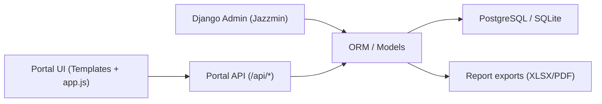

# Документация проекта Mirabad Avenue / HydroFlow

## 1. Назначение проекта
Проект — это Django-система для управления жилым сектором (`Mirabad Avenue`) с двумя основными контурами:
- операционный веб-портал (кастомный frontend на шаблонах + JS/CSS),
- административная панель Django (Jazzmin) и backend-API для операций по жильцам, платежам, уведомлениям и экспортам.

Система объединяет:
- учет структуры недвижимости (комплекс → дом → квартира → владелец),
- биллинг (отопление/ГВС, начисления, перерасчеты),
- транзакции и баланс жильцов,
- поддержку эксплуатационных процессов (алерты, аудит, чеклисты, support).

---

## 2. Технологический стек

### 2.1 Backend
Версии из `requirements.txt`:
- Python + Django `>=5.1,<6` (нужен `LoginRequiredMiddleware`)
- Django REST Framework `3.17.1`
- `drf-spectacular` `0.29.0` (OpenAPI schema + Swagger UI)
- `django-jazzmin` `3.0.4` (оформление admin)
- `django-cors-headers` `4.9.0`
- `psycopg2` `2.9.11` (PostgreSQL)
- `python-dotenv` `1.2.2` (загрузка `.env`)
- `openpyxl` `>=3.1,<4` (XLSX-экспорты)
- `reportlab` `>=4.2,<5` (PDF-экспорты)
- `aiogram` `3.31.0` (Telegram-бот жильцов, см. 13.1)

### 2.2 Frontend
- Django Templates
- Tailwind через CDN
- Chart.js через CDN
- Шрифт Inter и иконки Material Symbols через Google Fonts
- Кастомный `static/js/app.js`, `static/css/app.css` и адаптивный слой `static/css/responsive.css`
- Кастомный admin JS/CSS (`admin_custom.js`, `admin_custom.css`)

### 2.3 БД
- Основной сценарий: PostgreSQL через env-переменные.
- Fallback: SQLite (`db.sqlite3`) при отсутствии `DB_ENGINE`.

---

## 3. Архитектура (высокий уровень)

Ключевая идея:
- единый источник данных — Django модели,
- frontend получает агрегированную структуру через `api/portal-data` и специализированные list/action endpoints,
- изменения из портала пишутся в реальные модели + фиксируются в `AuditEvent`.

---

## 4. Структура репозитория

Корневые каталоги:
- `config/` — настройки проекта, root URLs, Jazzmin конфиг.
- `main_app/` — базовая доменная модель недвижимости и жильцов.
- `properties/` — proxy-модели для совместимости/переиспользования.
- `billing/` — расчетный контур и legacy-совместимость биллинга.
- `payments/` — транзакции и интеграционный слой Payme.
- `portal/` — операционная модель, backend-агрегация, API и экспорты.
- `telegram_bot/` — Telegram-бот жильцов (регистрация и привязка к резиденту по телефону), без своих моделей.
- `templates/` — layout, страницы, body-шаблоны и overlays.
- `static/` — frontend assets (JS/CSS, изображения).

Служебные файлы:
- `manage.py`
- `requirements.txt`
- `.env.example`
- `.gitignore` (игнорирует `.env`, `.venv/`, `local.sqlite3`, `static_collected/`, `media/`)
- `db.sqlite3` — пустая SQLite-база в репозитории; для локальной работы лучше указать свою (`DB_NAME`), чтобы не коммитить данные.

OpenAPI-схема в репозитории не хранится: она генерируется на лету (`/api/schema/`).

---

## 5. Конфигурация и запуск

### 5.1 Переменные окружения
Пример в `.env.example`:
- `SECRET_KEY`
- `DEBUG`
- `ALLOWED_HOSTS`
- `DB_ENGINE`, `DB_NAME`, `DB_HOST`, `DB_PORT`, `DB_USER`, `DB_PASSWORD`
- `CORS_ALLOW_ALL_ORIGINS`, `CORS_ALLOWED_ORIGINS`, `CORS_ALLOW_CREDENTIALS`
- HTTPS (необязательные): `SECURE_COOKIES`, `CSRF_TRUSTED_ORIGINS`, `USE_X_FORWARDED_PROTO`, `SECURE_SSL_REDIRECT`, `SECURE_HSTS_SECONDS`

Безопасные значения по умолчанию (если переменная не задана или пустая):
- `DEBUG=False`. Для локальной разработки нужно явно `DEBUG=True` в `.env`.
- Без `DEBUG` проект не запускается, если `SECRET_KEY` пустой или равен публичному значению (`replace-with-a-long-random-secret-key`, dev-ключ) — `ImproperlyConfigured`. При `DEBUG=True` подставляется dev-ключ.
- Cookies сессии и CSRF — только по HTTPS, пока не `DEBUG`. Для деплоя по чистому HTTP: `SECURE_COOKIES=False`.
- Если TLS завершается на прокси (nginx): `CSRF_TRUSTED_ORIGINS=https://<домен>` и/или `USE_X_FORWARDED_PROTO=True` (только если прокси сам выставляет `X-Forwarded-Proto`). Иначе POST-запросы по HTTPS получат ошибку CSRF «Origin checking failed».
- `SECURE_SSL_REDIRECT` и `SECURE_HSTS_SECONDS` выключены: включать, когда весь сайт работает по HTTPS (HSTS необратим для браузеров на срок действия). `manage.py check --deploy` напоминает о них предупреждениями `security.W004/W008`.
- CORS выключен (`CORS_ALLOWED_ORIGINS` пуст, без credentials): портал работает с того же origin.

`.env.example` рассчитан на локальную разработку: в нем `DEBUG=True`, PostgreSQL (`DB_ENGINE=django.db.backends.postgresql`) и CORS для `http://localhost:3000`. Для портала на том же origin CORS-строки можно удалить.

Важно:
- в рабочем `.env` хранятся реальные секреты/пароли — их нельзя публиковать.

### 5.2 Загрузка env
`config/settings.py` грузит только `BASE_DIR/.env`; переменные окружения процесса имеют приоритет над файлом. Других источников (соседних проектов и т.п.) нет.

### 5.3 База данных
- Если `DB_ENGINE` truthy: используется внешняя БД (обычно PostgreSQL).
- Иначе: SQLite.

### 5.4 Статические и медиа
- `STATIC_URL = /static/`
- `STATICFILES_DIRS = [BASE_DIR/static]`
- `STATIC_ROOT = BASE_DIR/static_collected`
- `MEDIA_URL = /media/`
- `MEDIA_ROOT = BASE_DIR/media`

### 5.5 Запуск (Windows)
1. `python -m venv .venv`
2. `.venv\Scripts\activate`
3. `pip install -r requirements.txt`
4. `copy .env.example .env` и оставить `DEBUG=True` (для SQLite очистить `DB_ENGINE`)
5. `python manage.py migrate`
6. `python manage.py createsuperuser`
7. `python manage.py runserver`
8. Открыть `/login/` и войти созданным пользователем.
9. (Необязательно) Telegram-бот: указать `TELEGRAM_BOT_TOKEN` в `.env` и в отдельном терминале запустить `python manage.py run_telegram_bot` (см. 13.1).

Тесты: `python manage.py test` (нужен `.env` из шага 4 либо `DEBUG=True` или `SECRET_KEY` в окружении).

### 5.6 Аутентификация
Портал и API закрыты: без сессии работают только `/login/`, `/admin/login/` и `/api/health/`.
- Страницы портала (не-DRF views): `LoginRequiredMiddleware` перенаправляет на `/login/?next=...`. Чтобы открыть view публично — декоратор `@login_not_required`.
- API (`@api_view`): DRF views исключены из middleware, поэтому в `REST_FRAMEWORK` заданы `IsAuthenticated` и `portal.authentication.PortalSessionAuthentication`. Без сессии ответ — `401` (а не `403`), и `app.js` по `401` отправляет пользователя на `/login/?next=<текущая страница>`. Публичный endpoint — через `@permission_classes([AllowAny])` (сейчас `api_health`, `api_logout`).
- POST-запросы от авторизованного пользователя проверяются на CSRF (заголовок `X-CSRFToken`, его отправляет `postPortalJson`).
- `/api/schema/` и `/api/docs/` тоже требуют входа.
- Вход — `django.contrib.auth.views.LoginView` с шаблоном `templates/portal/login.html` (en/ru/uz, тема и язык берутся из localStorage портала). Выход — `POST /api/logout/`, возвращает `redirectUrl` на `/login/`.
- Учётные записи создаёт администратор в Django admin; доступ к порталу есть у любого активного пользователя, к admin — только у `is_staff`.

---

## 6. URL-карта проекта

Root (`config/urls.py`):
- `/api/schema/` — OpenAPI schema (требует входа).
- `/api/docs/` — Swagger UI (требует входа).
- `/admin/main_app/sector/` — редирект на единый сектор.
- `/admin/` — Django admin.
- `/main-app/` — подключен, но в `main_app/urls.py` маршрутов нет.
- `/backend-billing/` — подключен, но в `billing/urls.py` маршрутов нет.
- `/backend-payments/` — подключен, но в `payments/urls.py` маршрутов нет.
- `/` — `portal.urls` (основной пользовательский интерфейс + API).

Portal page routes:
- `/login/` — вход (единственная публичная страница портала)
- `/` dashboard
- `/residential/`
- `/billing/`
- `/billing/periods/create` (и с `/` на конце)
- `/analytics/`

Почти у всех POST endpoints есть дубль без завершающего `/` (например, `/api/payments/create`), а `/api` перенаправляет на `/api/`.

---

## 7. Доменная модель (ORM)

## 7.1 `main_app` (базовая структура)

### `Complex`
Поля: `title`, `address`, `created_at`, `author`.
Особенность: `save()` принудительно задает `address = "Mirabad Avenue"`.

### `Building`
Поля: `number`, `address`, `complex(FK)`, `created_at`, `author`.

### `BuildingSection`
Поля: `building(FK)`, `name`; `unique_together(building, name)`.

### `Apartment`
Поля: `number`, `area`, `building(FK)`, `section(FK nullable)`, `balance`, `created_at`, `author`.

`balance` — лицевой счет квартиры. Счет принадлежит квартире, а не владельцу: начисления идут на него, даже если владельца нет, и долг остается за квартирой.

### `Owner`
Поля: `fio`, `phone`, `apartment(OneToOne)`, `balance`, `has_contract`,
`telegram_id`, `telegram_status`, `telegram_user`, `telegram_language`, `created_at`.

Telegram-поля заполняет бот (13.1): `telegram_status` — `connected` (Подключён) или `not_linked` (Не подключён, по умолчанию при создании); `telegram_language` — язык бота (`uz`/`ru`/`en`).

`Owner.balance` — копия счета его квартиры (обновляется вместе с ним). Новый владелец при создании получает текущий баланс квартиры, то есть долг или переплату, накопленные до него; смена квартиры у владельца тоже переносит его на счет новой квартиры.

Баланс:
- `> 0` — переплата,
- `< 0` — задолженность.

## 7.2 `properties` (proxy слой)
Proxy-модели (`Complex`, `Building`, `BuildingSection`, `Apartment`, `Owner`) над `main_app`.
Назначение: совместимость и альтернативные verbose names без дублирования таблиц.

## 7.3 `billing` (core + legacy совместимость)

### Core-модели
- `BillingPeriod`
- `BuildingService`
- `ServiceExpense`
- `HeatingApartmentUsage`
- `HotWaterReading`
- `Charge`
- `Payment`
- `RecalculationLog`

### Legacy-совместимость
- `Expense`
- `GasMeterReading`
- `HeatingRecord`
- `HotWaterMeterReading`
- `Invoice`
- `HeatingCalculationSummary`
- `HotWaterCalculationSummary`

### Логика ядра
`BillingPeriod` содержит методы:
- `close_period()` — рассчитывает тарифы, формирует `Charge`, списывает сумму с баланса жильцов (по одной `Transaction` типа `charge` на жильца, со ссылкой на `Invoice` периода).
- `reopen_period()` — переводит закрытый период в reopened.
- `recalculate(reason, author)` — отменяет старые начисления, создает новые, проводит разницу через `Transaction` типа `charge` (тег `[billing:recalculation]`), пишет `RecalculationLog`.

Квартиры без владельца начисляются так же, как остальные: тариф делится на площадь/расход всех квартир дома, `Charge` пустой квартиры создается с `owner = NULL`, сумма списывается со счета квартиры, а в `Invoice.owner_snapshot` пишется «Egasi biriktirilmagan». `recalculate()` корректирует счет пустой квартиры тем же способом.

`BuildingService.calculate()`:
- полная валидация,
- `total_expense` (expense items + газ, если задан),
- `total_volume` (по heated area или consumption),
- `tariff = total_expense / total_volume`,
- проставляет `is_calculated`, `calculated_at`.

`Payment.apply()` (billing.Payment):
- атомарно добавляет сумму к счету квартиры владельца через журнал (`Transaction` с типом по методу; `bank` → `manual`),
- защищает от повторного применения (`is_applied`).

## 7.4 `payments`

### `Transaction`
Единый журнал движений баланса:
- `payment_type` (`payme`, `click`, `cash`, `manual`, `charge`)
- `amount` (может быть +/-)
- `balance_before`, `balance_after`
- `external_id` (уникальный), `description`, `created_by`, `created_at`
- `apartment(FK)` — счет, к которому относится запись; `owner(FK, nullable)` — кто владел квартирой в момент записи (пусто для начислений пустой квартиры)
- `invoice(FK optional)`

### Баланс меняется только через журнал
`payments.services.apply_account_change(apartment_id, ...)` — единственный путь изменения счета: блокирует строку квартиры, затем владельца (`select_for_update`, всегда в этом порядке), считает `balance_before/after`, сохраняет `Apartment.balance` и копию в `Owner.balance` и создает `Transaction` в одной транзакции БД. `apply_balance_change(owner_id, ...)` — то же для счета квартиры владельца.
Через них проходят: платеж/списание из портала, `close_period`, `recalculate` (по квартирам, включая пустые), `billing.Payment.apply`. Начальный баланс в портале и admin не вводится: новый жилец получает текущий счет квартиры, а старый долг заносится списанием («Вычесть») в окне оплаты.
Инвариант по каждой квартире: начальный баланс + сумма `Transaction.amount` = `Apartment.balance`, и `balance_before` каждой записи равен `balance_after` предыдущей. История счета в портале (журнал жильца, фильтр `owner_id`) — это вся история квартиры, включая записи до текущего владельца.

- В admin и портале поля баланса нет ни при создании, ни при правке жильца/квартиры: баланс меняется только платежом или корректировкой в портале. Тег `[opening-balance]` остается у старых записей (и не считается платежом).
- «Платежом» (сумма собранного, последний платеж, статус `Success`) считается только положительная запись, кроме `charge` и `[opening-balance]` (`is_incoming_payment` / `incoming_payment_q`).
- Блокировка строки реально работает на PostgreSQL; на SQLite `select_for_update` игнорируется (запись сериализуется самой БД).
- Записи, созданные до этого изменения, журналом не восстанавливаются — старая история может не объяснять баланс полностью.

### `PaymeTransaction`
Хранение callback/технических данных Payme.

## 7.5 `portal` (операционный слой)

Модели:
- `WorkspaceProfile`
- `PortalNotification`
- `SystemAlert`
- `ChecklistItem`
- `ChecklistNote`
- `AuditEvent`
- `PortalStatusOverride`
- `SupportTicket`

Назначение:
- operational UX (алерты, support, чеклисты),
- аудит пользовательских действий,
- UI-override статусов таблиц без изменения core-моделей.

---

## 8. Миграции и эволюция схемы

Миграции по приложениям:
- `main_app`: `0001_initial`, `0002_apartment_accounts`, `0003_normalize_telegram_status`, `0004_owner_telegram_fields`
- `billing`: `0001_initial`, `0002_apartment_accounts`
- `payments`: `0001_initial`, `0002_apartment_accounts`
- `properties`: `0001_initial`
- `portal`: `0001_initial`, `0002_alter_workspaceprofile_organization_and_more`, `0003_remove_system_health`

`main_app 0003/0004` сводят Telegram-статусы к двум: `0003` переводит старые значения (`connected`/`pending`/`review`/`not_linked`/пусто) в `connected`, если у жильца есть Telegram id или username либо статус «подключён», иначе в `not_linked` (так портал их и показывал); `0004` делает `telegram_status` полем с choices и default `not_linked` и добавляет `telegram_language`.

`*_apartment_accounts` вводят лицевой счет квартиры: `Apartment.balance` заполняется балансом ее владельца, у существующих `Transaction` проставляется `apartment` по владельцу, `Transaction.owner` и `Charge.owner` становятся необязательными (`SET_NULL`).

Ранние миграции (в т.ч. консолидация в единый сектор и backfill billing-core) были объединены в `0001_initial`, поэтому новая база создается сразу в актуальной схеме. Единый сектор поддерживается кодом: `Complex.save()` и admin-редирект `/admin/main_app/sector/`.

`portal 0003_remove_system_health` удаляет таблицы `MaintenanceTask`, `TelemetryNode`, `TelemetrySample` (страница System Health убрана) и чистит связанные с ними `PortalStatusOverride`. Операция необратима для данных в этих таблицах.

---

## 9. API портала

Все backend API маршруты находятся в `portal/urls.py`.
Все endpoints, кроме `GET /api/health/` и `POST /api/logout/`, требуют сессию; без неё — `401` (см. 5.6).

## 9.1 Сервисные GET endpoints
- `GET /api/` — root API links.
- `GET /api/health/` — healthcheck `{status: ok}`.
- `GET /api/portal-data/` — полный snapshot данных для UI.

## 9.2 List endpoints (GET, с пагинацией)
Формат ответа list endpoint:
- `results`, `page`, `page_size`, `total`, `pages`, `ordering`.

### `GET /api/lists/residents/`
Фильтры:
- `search`, `status`, `telegram`, `contract`, `owner_id`, `name`, `phone`, `telegram_user`,
`building`, `apartment`, `district`, `period`, `period_from`, `period_to`,
`complex_id`, `building_id`, `apartment_id`, `ordering`.

`search` ищет без учёта регистра по ФИО, телефону, номеру квартиры, номеру дома и названию сектора — тем же полям, что и командный поиск по данным страницы. Командный поиск (Ctrl+K) объединяет локальные совпадения с ответом этого endpoint: строки сервера тоже проверяются по запросу, а один жилец показывается один раз (по `ownerBackendId`).

### `GET /api/lists/transactions/`
Фильтры:
- `search`, `status`, `payment_type`, `district`, `period`, `period_from`, `period_to`,
`owner_id`, `complex_id`, `building_id`, `apartment_id`, `ordering`.

### `GET /api/lists/alerts/`
Фильтры:
- `search`, `severity`, `status`, `pinned`, `district`, `period`, `period_from`, `period_to`, `ordering`.

### `GET /api/lists/audit/`
Фильтры:
- `search`, `type`, `actor`, `district`, `period`, `period_from`, `period_to`,
`complex_id`, `owner_id`, `ordering`.

### `GET /api/lists/complexes/`
Фильтры:
- `search`, `debt_status`, `district`, `ordering`.

## 9.3 Action endpoints (POST)

### Audit/checklist/support/session
- `POST /api/audit/note/` — добавить `AuditEvent`.
- `POST /api/audit/export/` — выгрузка журнала аудита в XLSX.
- `POST /api/checklist/note/` — create/toggle checklist note.
- `POST /api/checklist/item/` — отметить/сбросить пункты чеклиста.
- `POST /api/support/ticket/` — создать `SupportTicket` + `AuditEvent`.
- `POST /api/logout/` — logout + `redirectUrl` (`/login/`). GET больше не поддерживается.

### CRUD из портала
- `POST /api/complexes/create/` — **disabled** (возвращает 410, single-sector политика).
- `POST /api/buildings/create/` — создать дом.
- `POST /api/apartments/create/` — создать квартиру.
- `POST /api/residents/create/` — создать жильца (owner) для квартиры.
- `POST /api/payments/create/` — создать транзакцию и обновить баланс owner. `credit` принимает только каналы, которыми работают операторы: наличные (`cash`), карта через терминал (`card`) и перевод на карту компании в офисе (`transfer`, тег `[portal:transfer-credit]`; в списках, отчётах и статистике — отдельный канал «Перевод на карту»); `debit` — списание. Платежи Payme/Click через портал не вводятся: они придут из интеграций этих сервисов (400 на такие каналы).

### Resident tools
- `POST /api/resident-kit/action/` — три действия:
  - `move_in_checklist`
  - `reminder_script`
  - `contact_sheet`

### Alerts / statuses
- `POST /api/system-alerts/configure/` — create/acknowledge/resolve системных алертов + sync с `PortalNotification`.
- `POST /api/technicians/assign/` — назначить техника (alert/notification/resident fallback).
- `POST /api/status/assign/` — статусы для residential/transactions.

### Экспорт и напоминания
- `POST /api/usage-report/export/` — фиксирует событие экспорта usage report.
- `POST /api/export/report/` — универсальный экспорт (`XLSX`/`PDF`), в т.ч. специализированные billing report types.
- `POST /api/reminders/send/` — создать reminder-уведомления для целевых жильцов.
- Платёжное уведомление (`portal/billing_notice.py` — единый источник текста для окна, PDF и Telegram; UZ/RU). Состав: сектор, дом, квартира, абонент, телефон, лицевой счёт, дата, сумма долга; напоминание, просьба погасить, правовое основание и предупреждение о взыскании через суд; подписи «Руководитель предприятия» (`BILLING_NOTICE_DIRECTOR`) и «Ответственный сотрудник» (оператор, который формирует уведомление). Правовые ссылки проверены по lex.uz (16.10.2026): Жилищный кодекс ст. 132, 134, 140, 141; Закон «Об управлении многоквартирными домами» ЗРУ-581 ст. 16; Гражданский кодекс ст. 236, 237. Тексты меняются только в `TEXTS` этого модуля; перед массовой рассылкой их стоит согласовать с юристом.
  - `GET /api/billing-notice/preview/?owner_id=&language=uz|ru` — уведомление как данные (для окна).
  - `POST /api/billing-notice/pdf/` (`owner_id`, `language`) — PDF (кнопка «Скачать PDF»), `AuditEvent` «Payment notice downloaded as PDF»; 409 — нет долга.
- `POST /api/billing-notice/telegram/` (`owner_id`, `language`) — отправить жильцу это же уведомление текстом через бота (кнопка «Уведомить в Telegram») и записать `AuditEvent` типа `reminder`. Ошибки: 404 — жилец не найден; 409 — не подключён к Telegram или нет долга; 502 — Telegram не доставил (например, жилец заблокировал бота); 503 — не задан `TELEGRAM_BOT_TOKEN`.

## 9.4 Период-фильтрация
`_apply_period_filter` поддерживает:
- custom range: `period_from` / `period_to`
- preset: `period=30`, `period=90`, `period=month`, `period=all`.

---

## 10. Контракт `portal-data`

Top-level ключи snapshot (`GET /api/portal-data/`):
- `source`, `generatedAt`, `profile`, `adminUsers`,
- `complexes`, `residents`, `transactions`,
- `notifications`, `systemAlerts`,
- `auditEvents`, `checklistItems`, `checklistNotes`,
- `supportTickets`, `supportSummary`,
- `paymentSummary` — итоги платежей за всю историю (см. ниже).

`transactions` в snapshot — только последние `RECENT_TRANSACTIONS_PER_ACCOUNT` (5) записей каждого счета: их хватает для drawer'ов и «последней активности». Все, что опирается на всю историю, считается на backend:
- `paymentSummary.monthly` — успешные входящие платежи по (месяц, дом, канал): сумма, число операций, число счетов; из него страница статистики строит KPI месяца, каналы и динамику за 6 месяцев;
- `paymentSummary.months` — месяцы, в которых есть записи (список месяцев на странице статистики);
- `paymentSummary.channels` — итоги по каналам за все время (карточки каналов на странице платежей);
- `paymentSummary.currentMonthPayments` — число успешных платежей за текущий месяц;
- собранная сумма и дата последнего платежа жильца — `account_payment_totals()` (SQL-агрегат).

Полную историю счета (окно истории жильца, экспорт транзакций) frontend и экспорт берут из `/api/lists/transactions/` и из БД.

Ключевые схемы строк:
- resident row: идентификаторы backend/slugs, контакты, баланс, telegram, contract.
- complex row: здания, юниты, риск, debt, collected, объем ГВС (`waterM3`).
- transaction row: signed amount, payment type/method, before/after balances.

Источник данных для snapshot: `portal/backend_data.py` (`build_portal_data`).

Строки описываются одними функциями и в snapshot, и в `/api/lists/*` (`portal/backend_data.py`): `serialize_resident`, `serialize_transaction`, `serialize_complex`, `serialize_notification`, `serialize_audit_event`, плюс `residential_override_maps` / `transaction_override_map` для статусов, назначенных в портале. Новое поле добавляется в одном месте и появляется в обоих источниках; тест `test_snapshot_and_list_endpoints_describe_rows_identically` это проверяет.
- `telegramStatus` — `Owner.telegram_status`: `connected` / `not_linked` (его ставит Telegram-бот); `telegramConnected` — то же как boolean.
- `/api/lists/complexes/` дополнительно отдает `debt` (= `extraDebt`) и `finances` (= `health`) — только для сортировки этого списка.

### Производительность snapshot
Snapshot встраивается в каждую страницу, возвращается каждым POST и запрашивается страницей dashboard каждые 15 с. Раньше он нес всю историю `Transaction` (≈94% объема); теперь его размер зависит от числа квартир, а не от длины истории.

Замеры (SQLite, 1200 жильцов, ≈57 600 транзакций ≈ 2 года истории):

| Путь | Исходно | Этап 1 (сериализация, gzip) | Этап 2 (5 записей на счет + итоги) |
|---|---|---|---|
| `GET /` (страница) | 52 с, 50 МБ | 1.4 с, 0.97 МБ по сети (30 МБ после распаковки) | 0.8 с, 0.23 МБ по сети (5.1 МБ после распаковки) |
| `GET /api/portal-data/`, любой POST | 6.5–6.7 с, 30 МБ | 1.4 с, 0.95 МБ по сети | 0.75 с, 0.21 МБ по сети |
| Загрузка страницы в браузере (DOMContentLoaded) | — | ≈2.3 с | — |

Правила, которые держат эти цифры:
- В шаблон данные вставляются как `<script id="hydroflow-backend-data" type="application/json">` (`_json_for_script_tag`), а не через `escapejs` — тот обрабатывал 30 МБ посимвольно ≈45 с.
- В `build_portal_data` транзакции грузятся без `select_related` (владелец/квартира/дом берутся из уже загруженных владельцев), подписи `payment_type` вычисляются один раз (`_payment_type_labels`), а не через ленивый перевод на каждую строку.
- `GZipMiddleware` сжимает ответы (JSON сжимается ≈30×).
- Выходные данные snapshot при оптимизациях этапа 1 не менялись (проверено побайтовым сравнением). На этапе 2 строки жильцов и комплексов и все цифры статистики/каналов совпадают с прежними, посчитанными по полной истории (сравнено на той же базе).

Оставшееся ограничение: snapshot по-прежнему растет с числом квартир (строки жильцов и вложенные квартиры комплексов).

---

## 11. Экспортный контур

Файлы:
- `portal/views.py` — endpoints `POST /api/export/report/` и `POST /api/audit/export/`: собирают строки и заголовки,
- `portal/report_exports.py` — единственный генератор файлов: billing-отчеты (`build_report_payload`) и простые таблицы (`build_table_export` — экспорт жилого фонда, транзакций и журнала аудита).

Фронтенд файлы не генерирует: он вызывает эти endpoints и сохраняет `download` (base64) из ответа. Экспорт транзакций читает записи из БД (`_export_transaction_items`), а не из snapshot, поэтому выгружает всю историю.

Генератор:
- XLSX — openpyxl; стили тела таблицы заданы именованными стилями (`NamedStyle`), иначе 57 600 строк собирались ≈30 с (сейчас ≈4 с).
- PDF — reportlab, альбомный A4, все строки на нужном числе страниц. Шрифт с кириллицей ищется по `REPORT_FONT_CANDIDATES` (Arial на Windows/macOS, DejaVu Sans на Linux); если ни одного нет, используется Helvetica и кириллица в PDF не отобразится — на сервере нужен пакет шрифтов DejaVu.

Поддерживаемые report types (`report_exports.py`):
- `hot_water`
- `heating`
- `payments`
- `all`

Форматы:
- `XLSX` (openpyxl, многошитовые книги + стили),
- `PDF` (reportlab, таблицы и summary).

Контексты табличного экспорта: `residential`, `transactions`. Неизвестный контекст определяется по `source`: `transactions`, если в нем есть «transaction», иначе `residential`.

Фильтры в payload экспорта:
- `complex_backend_ids`
- `building_backend_ids`
- `apartment_backend_ids`
- `owner_ids`
- `transaction_backend_ids`
- `date_from`, `date_to`

---

## 12. Frontend архитектура

## 12.1 Шаблоны
- `templates/base.html` — основной layout, подключение Tailwind CDN, Chart.js, `app.css`, `app.js`, гидрация `window.HydroFlowBackendData` из `<script id="hydroflow-backend-data" type="application/json">`.
- `templates/partials/sidebar.html`, `topbar.html`.
- `templates/partials/app_overlays.html` — модалки/дроверы.
- `templates/portal/login.html` — самостоятельная страница входа (не наследует `base.html`).
- Страницы: `dashboard`, `residential`, `billing`, `analytics`, `billing_period_create`.
- Body-фрагменты: `templates/portal/bodies/*.html`.

## 12.2 Оверлеи (23 модалки и дровера)
Ключевые группы:
- notifications/audit/support/checklist/profile/settings drawers,
- details/apartment details drawers,
- create/modification modals (`create-building`, `create-apartment`, `add-payment`, `system-alerts-config`, `assign-status`, `export-preview`, `billing-notice`, `confirm`).
- Окна: `openOverlayById` не открывает уже открытое окно повторно и играет один звук на открытие; `HydroFlowSyncLocale()` (перевод нового содержимого) не рассылает `hydroflow:language-changed` — это событие только для реальной смены языка. Раньше эта рассылка заново открывала окно истории (рывок и двойной звук) и стоила ~500 мс на каждый рендер.
- Окно истории жильца: колонки ID, дата и время, оператор (`createdBy`, у системных записей — «Система»), тип оплаты, сумма, баланс до, баланс после; заголовки стоят точно над колонками. Те же поля — в журнале на странице платежей (плюс жилец и статус, сортировка по оператору) и в экспорте транзакций.
- Список жильцов: колонка «Дом / кв.» (сортировка по дому, затем квартире); заголовки колонок выровнены по строкам; Telegram — `@username`, «Не найден», если жилец подключен без username, «Не подключён», если не зарегистрирован в боте (так же в профиле и окне оплаты).
- Живое обновление (dashboard, каждые 15 с и при возврате на вкладку): если изменились жильцы, балансы, Telegram или появились новые транзакции (отпечаток snapshot), серверные списки перезагружаются — новый жилец из admin появляется без обновления страницы.
- `add-payment`: открывается из быстрых действий или кнопкой «Оплата» в строке жильца (сразу на этом жильце, курсор в поле суммы). Сумма вводится вручную (текстовое поле без стрелок; «500 000» и «1250,50» допустимы), каналы — наличные, карта (терминал) и перевод на карту. После сохранения окно закрывается, а серверные списки (жильцы, транзакции) перезагружаются, так что новый баланс виден сразу.

## 12.3 JS логика (`static/js/app.js`)
Крупный монолитный скрипт (~9.7k строк), включает:
- i18n словари (en/ru/uz),
- theme/lang state,
- таблицы (поиск, пагинация, сортировки, bulk-выбор),
- overlay orchestration,
- API-клиент для `/api/*`,
- рендер/rehydration из `portalData`,
- export/reminder/status workflows,
- chart behaviors.

Демо-данных во фронтенде нет: `billingData` стартует пустым и заполняется только из backend snapshot, аналитика всегда строится по реальным данным (при пустой базе — нули), в drawer'ах нет выдуманных значений (техник берется из назначенных алертов комплекса, история — из `AuditEvent`, поля без источника показывают «Not set»). Тесты `PortalDemoContentTests` следят, чтобы образцы записей не вернулись в шаблоны и `app.js`.

API пути, используемые frontend:
- `/api/portal-data/`
- `/api/lists/residents/`
- `/api/lists/transactions/`
- `/api/lists/alerts/`
- `/api/lists/audit/`
- `/api/residents/create/`
- `/api/buildings/create/`
- `/api/apartments/create/`
- `/api/payments/create/`
- `/api/system-alerts/configure/`
- `/api/audit/note/`
- `/api/audit/export/`
- `/api/checklist/note/`
- `/api/checklist/item/`
- `/api/support/ticket/`
- `/api/export/report/`
- `/api/reminders/send/`
- `/api/resident-kit/action/`
- `/api/status/assign/`
- `/api/logout/`

## 12.4 CSS
- `static/css/app.css` (~21.5k строк): темы, компоненты, анимации.
- `static/css/responsive.css`: адаптивный слой (desktop ≥1280px — полный sidebar, 768–1279px — icon rail, <768px — off-canvas drawer; сетки страниц через container queries), подключается после `app.css`.
- CSS vars (`:root`): `--hf-primary`, `--hf-surface`, `--hf-panel`, `--hf-border`, и т.д.

---

## 13. Django Admin и Jazzmin

Кастомизация:
- `config/jazz_sett.py`: topmenu links, иконки моделей, theme, custom assets.
- `static/js/admin_custom.js`: языковой свитчер, theme toggle, автоперевод UI, фильтры owner/apartment, balance preview.
- `static/css/admin_custom.css`: визуальная полировка admin интерфейса.

Особые правила admin-домена:
- единый сектор (`Mirabad Avenue`) enforced через `Complex.save()` и admin redirect.
- часть сущностей в admin read-only по бизнес-смыслу (например, transaction history/invoices, баланс жильца после создания).
- страница дома (`BuildingAdmin`): квартиры вводятся таблицей (`ApartmentInline`, форма `ApartmentInlineForm`), одна строка — квартира и ее владелец: номер, площадь, ФИО, телефон, договор, баланс.
  - ФИО и телефон заполнены — владелец создается (или обновляется существующий); пустые — квартира остается без владельца и все равно начисляется.
  - баланс: только показ текущего счета («—» у новой строки); ввести его здесь нельзя.
  - очистка ФИО/телефона у квартиры с владельцем — ошибка, а не удаление: убрать владельца можно только на странице резидента (там же Telegram-поля).
- admin сохраняет квартиру без поля `balance` (`save_apartment`), чтобы не перезаписать платеж, проведенный во время сохранения формы.
- страница квартиры (`ApartmentAdmin`): жилец добавляется вместе с квартирой — строка `OwnerInline` (ФИО, телефон, договор, статус Telegram только для чтения); пустая строка оставляет квартиру без владельца; удалить жильца отсюда нельзя.
- резидент (`OwnerAdmin`): поля баланса нет (только показ); Telegram-поля только для чтения — их заполняет бот; фильтр по статусу Telegram; действие «Отключить Telegram» очищает id/username/язык и ставит `not_linked`. В портале форма создания жильца не имеет ни Telegram-полей, ни баланса.

## 13.1 Telegram-бот жильцов

Приложение `telegram_bot` (aiogram 3), запуск: `python manage.py run_telegram_bot` (long polling, токен — `TELEGRAM_BOT_TOKEN` из `.env`). Это отдельный долгоживущий процесс: на сервере его запускают рядом с веб-приложением (systemd/supervisor/pm2) с тем же `.env` и той же БД.

Сценарий:
1. `/start` → выбор языка (O'zbekcha / Русский / English); дальше все сообщения и кнопки на выбранном языке.
2. Ф.И.О. → телефон кнопкой «Отправить контакт». Принимается только собственный контакт пользователя (`contact.user_id` = отправитель): Telegram подтверждает, что номер его, поэтому ввести чужой номер нельзя.
3. Бот показывает введенные данные → «Подтвердить» / «Отклонить». «Отклонить» начинает регистрацию заново (с Ф.И.О., язык сохраняется).
4. «Подтвердить» → `services.link_by_phone`: ищет резидентов с этим телефоном (сравниваются последние 9 цифр, формат и код страны не важны), всем найденным ставит `telegram_id`, `telegram_user`, `telegram_language`, `telegram_status = connected` и пишет `AuditEvent` «Telegram connected». Если номер не найден — сообщение с кнопкой «Попробовать снова» и `AuditEvent` «phone not found» (администратор видит, кто не смог зарегистрироваться).
5. Зарегистрированный пользователь по `/start` попадает в главное меню: его квартиры с балансом (долг/переплата), кнопки «Баланс» и «Сменить язык».

Уведомления из портала: в окне платёжного уведомления (Billing → «Generate Billing Notice») перечислены только должники (баланс < 0): жилец с нулевым балансом или переплатой и пустая квартира в список не попадают; если окно открыто для такого жильца из его профиля, показывается «У резидента нет долга». Подключённые к Telegram должники помечены «Telegram подключён»; кнопка «Уведомить в Telegram» отправляет выбранному жильцу показанное в окне платёжное уведомление на выбранном там языке (`notifications.send_debt_notice`, текст из `portal/billing_notice.py`, endpoint `POST /api/billing-notice/telegram/`, см. 9.3). Отправка идет напрямую через Bot API с тем же токеном, поэтому процесс `run_telegram_bot` для неё не нужен; жилец получает сообщение, только если он когда-то нажал /start у этого бота.

Файлы: `handlers.py` (диалог и `build_router()`), `texts.py` (тексты и кнопки на 3 языках), `keyboards.py`, `states.py` (FSM), `services.py` (вся работа с БД через `sync_to_async`), `notifications.py` (уведомление о долге из портала), `runner.py` (бот, диспетчер, закрытие устаревших соединений БД вокруг каждого апдейта).

Ограничение: состояние диалога хранится в памяти процесса — после перезапуска бота незавершенная регистрация начинается заново.

---

## 14. Тесты и качество

Запуск: `python manage.py test` — 111 тестов (нужен `.env` или `DEBUG=True`, см. 5.5).

Наличие тестов:
- `billing/tests.py` (24) — core биллинга: расчеты, `close_period`, `recalculate`, `Payment.apply`, проводки в журнал, начисления пустой квартире и переход ее долга к новому владельцу.
- `payments/tests.py` (9) — журнал баланса: `apply_balance_change`, платежи из портала, отсутствие ввода баланса в портале и admin (новый жилец получает счет квартиры), что считается платежом.
- `portal/tests.py` (44) — поиск жильцов (`search` в `/api/lists/residents/`), платёжное уведомление (содержание, правовые ссылки, оператор, PDF, отказ без долга), вход/выход и закрытость страниц и API, CSRF, каналы ручного платежа (наличные/карта/перевод на карту; перевод — отдельный канал в списках и статистике), snapshot (`<script>`-встраивание, gzip, совпадение snapshot и `/api/lists/*`, 5 записей на счет, итоги за всю историю), долг пустой квартиры в портале, XLSX/PDF-экспорты, отсутствие демо-данных, удаленные страницы System Health.
- `config/tests.py` (5) — безопасные настройки production (секретный ключ, cookies) в отдельных процессах.
- `main_app/tests.py` (11) — страница дома в admin: создание квартир с владельцами без ввода баланса, страница квартиры с жильцом (и без), владелец пустой квартиры принимает ее долг, правка существующего владельца, проверки полей, защита от удаления владельца очисткой строки, сохранение квартиры не затирает баланс; миграция Telegram-статусов; действие «Отключить Telegram».
- `telegram_bot/tests.py` (18) — тексты на 3 языках, сравнение телефонов, привязка к одному и нескольким резидентам, неизвестный номер; весь диалог бота через диспетчер aiogram без обращения к Telegram (подтверждение, отклонение, только свой контакт, «Попробовать снова», главное меню и смена языка); уведомление о долге из портала (текст на языке жильца, журнал, отказ без Telegram/без долга/без токена, бот заблокирован).

Не покрыты: большинство action endpoints портала (создание дома/квартиры/жильца, алерты, чеклисты, напоминания, статусы), фильтры list endpoints и frontend (JS) — автотестов браузера нет.

---

## 15. Текущие ограничения и риски

1. Сильная монолитность frontend:
- `app.js` и `app.css` очень большие, низкая модульность.

2. Неполное тестовое покрытие:
- биллинг, журнал баланса, аутентификация и экспорты покрыты; action endpoints портала и frontend — нет (см. раздел 14).

3. Зависимость от env-конфигурации и внешних пакетов:
- для корректного тест/экспорт контура нужны установленные `openpyxl` и `reportlab`.

4. Схема single-sector:
- создание новых комплексов отключено на API уровне (`410`), что нужно учитывать в дальнейшем roadmap.

---

## 16. Рекомендации на следующий этап разработки

1. Разбить frontend-монолит:
- вынести API client, overlay manager, table layer, i18n и page-specific controllers в отдельные модули.

2. Закрыть тестовые пробелы:
- API тесты для action endpoints `portal/views.py` (create building/apartment/resident, alerts, checklist, reminders, statuses) и фильтров list endpoints,
- браузерные smoke tests основных страниц на desktop/tablet/phone.

3. Упорядочить контракты API:
- формализовать request/response схемы для action endpoints (сейчас OpenAPI в основном `additionalProperties`).

4. Секреты и конфигурация:
- вынести реальные секреты из рабочего `.env`, оставить только безопасный шаблон.

5. Документацию держать актуальной:
- обновлять этот документ при каждом изменении моделей, API и frontend контрактов.

---

## 17. Быстрая памятка по ключевым файлам

Backend:
- `config/settings.py`
- `config/urls.py`
- `main_app/models.py`
- `billing/models.py`
- `payments/models.py`
- `portal/models.py`
- `portal/views.py`
- `portal/backend_data.py`
- `portal/report_exports.py`
- `telegram_bot/handlers.py`, `telegram_bot/services.py`, `telegram_bot/texts.py`

Frontend:
- `templates/base.html`
- `templates/partials/sidebar.html`
- `templates/partials/topbar.html`
- `templates/partials/app_overlays.html`
- `templates/portal/bodies/*.html`
- `static/js/app.js`
- `static/css/app.css`
- `static/css/responsive.css`

Admin UX:
- `config/jazz_sett.py`
- `static/js/admin_custom.js`
- `static/css/admin_custom.css`

---

## 18. Статус документа
Документ сверен с кодом репозитория (маршруты, модели, миграции, API, snapshot, тесты) после удаления страницы System Health и добавления адаптивного слоя. При изменении моделей, API или frontend-контрактов обновляйте соответствующий раздел.
