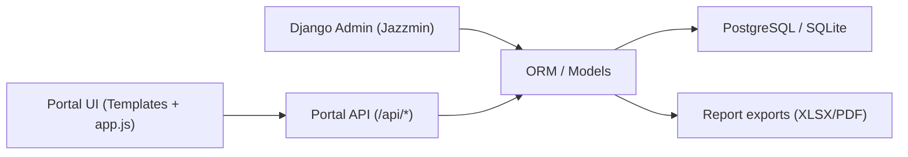

# Документация проекта Mirabad Avenue / HydroFlow

## 1. Назначение проекта
Проект — это Django-система для управления жилым сектором (`Mirabad Avenue`) с двумя основными контурами:
- операционный веб-портал (кастомный frontend на шаблонах + JS/CSS),
- административная панель Django (Jazzmin) и backend-API для операций по жильцам, платежам, уведомлениям и экспортам.

Система объединяет:
- учет структуры недвижимости (комплекс → дом → квартира → владелец),
- биллинг (отопление/ГВС, начисления, перерасчеты),
- транзакции и баланс жильцов,
- поддержку эксплуатационных процессов (алерты, аудит, чеклисты, support).

---

## 2. Технологический стек

### 2.1 Backend
Версии из `requirements.txt`:
- Python + Django `>=5.1,<6` (нужен `LoginRequiredMiddleware`)
- Django REST Framework `3.17.1`
- `drf-spectacular` `0.29.0` (OpenAPI schema + Swagger UI)
- `django-jazzmin` `3.0.4` (оформление admin)
- `django-cors-headers` `4.9.0`
- `psycopg2` `2.9.11` (PostgreSQL)
- `python-dotenv` `1.2.2` (загрузка `.env`)
- `openpyxl` `>=3.1,<4` (XLSX-экспорты)
- `reportlab` `>=4.2,<5` (PDF-экспорты)
- `aiogram` `3.31.0` (Telegram-бот жильцов, см. 13.1)

### 2.2 Frontend
- Django Templates
- Tailwind 3.4.17: готовый файл `static/css/tailwind.css`, собранный из `frontend/` (см. 12.4); Play CDN, который
  собирал CSS в каждом браузере при каждой загрузке, больше не используется
- Chart.js 4.5.1 через CDN, только на странице «Статистика»
- Шрифт Inter (один variable-файл `wght@300..900`) и иконки Material Symbols через Google Fonts — только
  используемые иконки (`icon_names`, ≈80 КБ вместо 1.1 МБ)
- Кастомный `static/js/app.js`, `static/css/app.css` и адаптивный слой `static/css/responsive.css`
- Кастомный admin JS/CSS (`admin_custom.js`, `admin_custom.css`)

### 2.3 БД
- Основной сценарий: PostgreSQL через env-переменные.
- Fallback: SQLite (`db.sqlite3`) при отсутствии `DB_ENGINE`.

---

## 3. Архитектура (высокий уровень)

Ключевая идея:
- единый источник данных — Django модели,
- frontend получает агрегированную структуру через `api/portal-data` и специализированные list/action endpoints,
- изменения из портала пишутся в реальные модели + фиксируются в `AuditEvent`.

---

## 4. Структура репозитория

Корневые каталоги:
- `config/` — настройки проекта, root URLs, Jazzmin конфиг.
- `main_app/` — базовая доменная модель недвижимости и жильцов.
- `properties/` — proxy-модели для совместимости/переиспользования.
- `billing/` — расчетный контур и legacy-совместимость биллинга.
- `payments/` — транзакции и интеграционный слой Payme.
- `portal/` — операционная модель, backend-агрегация, API и экспорты.
- `telegram_bot/` — Telegram-бот жильцов (регистрация и привязка к резиденту по телефону), без своих моделей.
- `templates/` — layout, страницы, body-шаблоны и overlays.
- `static/` — frontend assets (JS/CSS, изображения).

Служебные файлы:
- `manage.py`
- `requirements.txt`
- `.env.example`
- `.gitignore` (игнорирует `.env`, `.venv/`, `local.sqlite3`, `static_collected/`, `media/`)
- `db.sqlite3` — пустая SQLite-база в репозитории; для локальной работы лучше указать свою (`DB_NAME`), чтобы не коммитить данные.

OpenAPI-схема в репозитории не хранится: она генерируется на лету (`/api/schema/`).

---

## 5. Конфигурация и запуск

### 5.1 Переменные окружения
Пример в `.env.example`:
- `SECRET_KEY`
- `DEBUG`
- `ALLOWED_HOSTS`
- `DB_ENGINE`, `DB_NAME`, `DB_HOST`, `DB_PORT`, `DB_USER`, `DB_PASSWORD`
- `CORS_ALLOW_ALL_ORIGINS`, `CORS_ALLOWED_ORIGINS`, `CORS_ALLOW_CREDENTIALS`
- HTTPS (необязательные): `SECURE_COOKIES`, `CSRF_TRUSTED_ORIGINS`, `USE_X_FORWARDED_PROTO`, `SECURE_SSL_REDIRECT`, `SECURE_HSTS_SECONDS`
- `TRUST_X_FORWARDED_FOR` (по умолчанию `False`): включать только за прокси (nginx), который дописывает `X-Forwarded-For`, — тогда журнал действий записывает IP клиента, а не прокси.

Безопасные значения по умолчанию (если переменная не задана или пустая):
- `DEBUG=False`. Для локальной разработки нужно явно `DEBUG=True` в `.env`.
- Без `DEBUG` проект не запускается, если `SECRET_KEY` пустой или равен публичному значению (`replace-with-a-long-random-secret-key`, dev-ключ) — `ImproperlyConfigured`. При `DEBUG=True` подставляется dev-ключ.
- Cookies сессии и CSRF — только по HTTPS, пока не `DEBUG`. Для деплоя по чистому HTTP: `SECURE_COOKIES=False`.
- Если TLS завершается на прокси (nginx): `CSRF_TRUSTED_ORIGINS=https://<домен>` и/или `USE_X_FORWARDED_PROTO=True` (только если прокси сам выставляет `X-Forwarded-Proto`). Иначе POST-запросы по HTTPS получат ошибку CSRF «Origin checking failed».
- `SECURE_SSL_REDIRECT` и `SECURE_HSTS_SECONDS` выключены: включать, когда весь сайт работает по HTTPS (HSTS необратим для браузеров на срок действия). `manage.py check --deploy` напоминает о них предупреждениями `security.W004/W008`.
- CORS выключен (`CORS_ALLOWED_ORIGINS` пуст, без credentials): портал работает с того же origin.

`.env.example` рассчитан на локальную разработку: в нем `DEBUG=True`, PostgreSQL (`DB_ENGINE=django.db.backends.postgresql`) и CORS для `http://localhost:3000`. Для портала на том же origin CORS-строки можно удалить.

Важно:
- в рабочем `.env` хранятся реальные секреты/пароли — их нельзя публиковать.

### 5.2 Загрузка env
`config/settings.py` грузит только `BASE_DIR/.env`; переменные окружения процесса имеют приоритет над файлом. Других источников (соседних проектов и т.п.) нет.

### 5.3 База данных
- Если `DB_ENGINE` truthy: используется внешняя БД (обычно PostgreSQL).
- Иначе: SQLite.

### 5.4 Статические и медиа
- `STATIC_URL = /static/`
- `STATICFILES_DIRS = [BASE_DIR/static]`
- `STATIC_ROOT = BASE_DIR/static_collected`
- `MEDIA_URL = /media/`
- `MEDIA_ROOT = BASE_DIR/media`

### 5.5 Запуск (Windows)
1. `python -m venv .venv`
2. `.venv\Scripts\activate`
3. `pip install -r requirements.txt`
4. `copy .env.example .env` и оставить `DEBUG=True` (для SQLite очистить `DB_ENGINE`)
5. `python manage.py migrate`
6. `python manage.py createsuperuser`
7. `python manage.py runserver`
8. Открыть `/login/` и войти созданным пользователем.
9. (Необязательно) Telegram-бот: указать `TELEGRAM_BOT_TOKEN` в `.env` (и при желании `TELEGRAM_BOT_USERNAME` — @username бота для ссылок подключения операторов; без него он берётся из Telegram) и в отдельном терминале запустить `python manage.py run_telegram_bot` (см. 13.1).

Тесты: `python manage.py test` (нужен `.env` из шага 4 либо `DEBUG=True` или `SECRET_KEY` в окружении).

### 5.7 Импорт реестра абонентов
`python manage.py import_abonents <папка> [--dry-run]` загружает дома, квартиры, лицевые счета, площади и владельцев. В папке — по одному файлу на дом, имя файла = номер дома (`60.xlsx`, `60V.xlsx`, `62.xlsx`, `64.xlsx`, `64V.xlsx`, `66.xlsx`, `66V.xlsx`), колонки `Abonent turi`, `Abonent raqami`, `F.I.O.`, `Manzil`, `Kadastr raqami`, `Umumiy maydon`.

- Номер квартиры берётся из адреса (`кв. 24a` → `24A`, `137A-xonadon` → `137A`, `64-V, 12` → `12`); нежилые — `неж3` из `неж3`, `неж` если в доме одно ненумерованное, иначе `неж1`, `неж2`, ... по порядку строк.
- Квартира ищется по лицевому счёту, затем по дому и номеру, поэтому повторный запуск обновляет данные на месте. Балансы, телефоны, Telegram и расчётные данные не меняются.
- Любая проблема (повтор лицевого счёта, адрес без номера, нет площади) останавливает импорт целиком; `--dry-run` только проверяет файлы и печатает замечания.
- Кадастровый номер и тип абонента не сохраняются (в моделях нет таких полей).

Первичная загрузка 2026-10-20: 7 домов, 953 помещения (938 квартир и 15 нежилых), 953 владельца.

### 5.6 Аутентификация
Портал и API закрыты: без сессии работают только `/login/`, `/admin/login/` и `/api/health/`.
- Страницы портала (не-DRF views): `LoginRequiredMiddleware` перенаправляет на `/login/?next=...`. Чтобы открыть view публично — декоратор `@login_not_required`.
- API (`@api_view`): DRF views исключены из middleware, поэтому в `REST_FRAMEWORK` заданы `IsAuthenticated` и `portal.authentication.PortalSessionAuthentication`. Без сессии ответ — `401` (а не `403`), и `app.js` по `401` отправляет пользователя на `/login/?next=<текущая страница>`. Публичный endpoint — через `@permission_classes([AllowAny])` (сейчас `api_health`, `api_logout`).
- POST-запросы от авторизованного пользователя проверяются на CSRF (заголовок `X-CSRFToken`, его отправляет `postPortalJson`).
- `/api/schema/` и `/api/docs/` тоже требуют входа.
- Вход — `django.contrib.auth.views.LoginView` с шаблоном `templates/portal/login.html` (en/ru/uz, тема и язык берутся из localStorage портала). Выход — `POST /api/logout/`, возвращает `redirectUrl` на `/login/`.
- Учётные записи создаёт администратор в Django admin; доступ к порталу есть у любого активного пользователя, к admin — только у `is_staff`.

---

## 6. URL-карта проекта

Root (`config/urls.py`):
- `/api/schema/` — OpenAPI schema (требует входа).
- `/api/docs/` — Swagger UI (требует входа).
- `/admin/main_app/sector/` — редирект на единый сектор.
- `/admin/` — Django admin.
- `/main-app/` — подключен, но в `main_app/urls.py` маршрутов нет.
- `/backend-billing/` — подключен, но в `billing/urls.py` маршрутов нет.
- `/backend-payments/` — подключен, но в `payments/urls.py` маршрутов нет.
- `/` — `portal.urls` (основной пользовательский интерфейс + API).

Portal page routes:
- `/login/` — вход (единственная публичная страница портала)
- `/` dashboard
- `/residential/`
- `/billing/`
- `/billing/periods/` — расчётные периоды (список + окно «Create»); `/billing/periods/create` перенаправляет сюда
- `/billing/periods/<id>/` — период как файл Excel: листы домов, таблицы «Isitish» / «Issiq suv»
- `/billing/periods/<id>/export/?lang=ru|uz|en` — выгрузка периода в .xlsx
- `/reports/` — «Отчёты»: отчёты по долгам и по потреблению (окно экспорта) и файлы расчётных периодов
- `/analytics/`

Почти у всех POST endpoints есть дубль без завершающего `/` (например, `/api/payments/create`), а `/api` перенаправляет на `/api/`.

---

## 7. Доменная модель (ORM)

## 7.1 `main_app` (базовая структура)

### `Complex`
Поля: `title`, `address`, `created_at`, `author`.
Особенность: `save()` принудительно задает `address = "Mirabad Avenue"`.

### `Building`
Поля: `number`, `address`, `complex(FK)`, `created_at`, `author`.

### `Apartment`
Поля: `number`, `area`, `building(FK)`, `personal_account`, `balance`, `created_at`, `author`.

`personal_account` — номер лицевого счёта (абонентский номер поставщика, например `1391677280`). Пустой, пока неизвестен; непустой номер уникален среди всех квартир (`apartment_personal_account_unique`). Показывается в админке (страница дома, список квартир, поиск), в карточке квартиры портала и ищется в списках жильцов и платежей.

`balance` — баланс счёта квартиры. Счёт принадлежит квартире, а не владельцу: начисления идут на него, даже если владельца нет, и долг остается за квартирой.

Нежилые помещения хранятся как квартиры с номером `неж`, `неж1`, `неж2`, ... (см. `import_abonents` в 5.7).

### `Owner`
Поля: `fio`, `phone`, `apartment(OneToOne)`, `balance`, `has_contract`,
`telegram_id`, `telegram_status`, `telegram_user`, `telegram_language`, `created_at`.

`phone` необязателен: в реестре абонентов телефонов нет, и такого владельца можно сохранить в админке; бот не связывает владельца с пустым телефоном.

Telegram-поля заполняет бот (13.1): `telegram_status` — `connected` (Подключён) или `not_linked` (Не подключён, по умолчанию при создании); `telegram_language` — язык бота (`uz`/`ru`/`en`).

`Owner.balance` — копия счета его квартиры (обновляется вместе с ним). Новый владелец при создании получает текущий баланс квартиры, то есть долг или переплату, накопленные до него; смена квартиры у владельца тоже переносит его на счет новой квартиры.

Баланс:
- `> 0` — переплата,
- `< 0` — задолженность.

## 7.2 `properties` (proxy слой)
Proxy-модели (`Complex`, `Building`, `Apartment`, `Owner`) над `main_app`.
Назначение: совместимость и альтернативные verbose names без дублирования таблиц.

## 7.3 `billing` (core + legacy совместимость)

### Core-модели
- `BillingPeriod`
- `BuildingService`
- `ServiceExpense`
- `HeatingApartmentUsage`
- `HotWaterReading`
- `Charge`

### Legacy-совместимость
- `Expense`
- `GasMeterReading`
- `HeatingRecord`
- `HotWaterMeterReading`
- `Invoice`
- `HeatingCalculationSummary`
- `HotWaterCalculationSummary`

### Формула расчёта (`billing/calculation.py`)
`build_plan(period)` по введённым данным периода рассчитывает каждый тариф и сумму каждой квартиры; этот же план показывает вкладка «Hisob-kitob» в admin и использует закрытие периода, поэтому предпросмотр совпадает с начислениями.

**Отопление** — по дому целиком:
- отопление меняется от месяца к месяцу, поэтому задаётся в каждом периоде, а не у квартиры: `HeatingRecord` (период × квартира) — `heated_from` (начало; пусто — в этом периоде не отапливалась, не начисляется и не входит в объём), `heated_until` (последний день; пусто — до конца периода), `days_given` («Berilgan kunlar»: сколько дней отопление дано; пусто — все дни между датами), `excluded_dates` (даты без отопления, старый способ);
- «Сутки» = дни с `heated_from` по `heated_until` включительно в пределах периода (полный декабрь — 31); дни расчёта = `days_given`, если задано (не больше «Сутки»), иначе «Сутки» минус `excluded_dates`. Пример из Excel: декабрь 31 сутки, дано 30 дней, 171,94 м² × 30 = 5 158,2;
- строки `HeatingRecord` и `HotWaterMeterReading` создаёт `sync_default_records()` для всех квартир домов периода (при создании периода и «Обновить»), как новый лист Excel: отопление — весь период, ГВС — пустые показания (начальное берётся из прошлого месяца);
- расходы дома = строки `Expense` (обслуживание котельной, холодная вода и т. п.) + газовые счётчики (расход × цена за м³);
- тариф = расходы / Σ(площадь × дни); сумма квартиры = площадь × дни × расходы / Σ (округление один раз, до тийина).

**Горячая вода (ГВС)** — по дому: расходы дома (котельная, электроэнергия, газ) делятся на сумму расхода по счётчикам квартир; сумма = м³ × расходы / Σ м³.
- Начальное показание квартиры (`HotWaterMeterReading.start_reading`), если пусто, берётся из последнего показания прошлого периода (конечное, иначе начальное). То же для газового счётчика (`GasMeterReading.start_reading`: конечное показание того же дома и услуги за прошлый период).
- Нет конечного показания — квартира в этом месяце не начисляется (предупреждение), расход войдёт в следующий месяц.

**Что не даёт закрыть период** (все проблемы показываются сразу, с номером дома и квартиры, на узбекском):
- расходы есть, а объём 0 (в периоде нет отапливаемых квартир / нет показаний ГВС);
- конечное показание меньше начального; нет начального показания и нет прошлого (для нового счётчика — ввести 0).

Услуги ядра, построенные из введённых данных (`BuildingService.is_from_inputs`), при каждом закрытии/перерасчёте пересобираются из них: удалённый расход перестаёт начисляться. Услуги, созданные напрямую (без введённых данных), не трогаются. Уникальность услуги: (период, дом, тип).

### Логика ядра
`BillingPeriod` содержит методы:
- `close_period()` — проверяет план расчёта (ошибки → `ValidationError` со списком), пересобирает услуги, формирует `Charge`, списывает сумму с баланса жильцов (по одной `Transaction` типа `charge` на жильца, со ссылкой на `Invoice` периода).
- `reopen_period()` — переводит закрытый период в reopened.
- `expense_totals()` / `total_expenses()` — расходы периода по (дом, услуга) и в сумме: строки `Expense` плюс стоимость газовых счётчиков `GasMeterReading` (расход × цена за м³). Колонка «Общие расходы» в admin показывает `total_expenses()`; при закрытии газ попадает в `ServiceExpense` услуги («Gaz: … m³ × … so'm») и распределяется по жильцам вместе с остальными расходами.
- `recalculate(reason, author)` — отменяет старые начисления, создает новые, проводит разницу через `Transaction` типа `charge` (тег `[billing:recalculation]`, в описании — причина); портал пишет перерасчёт в журнал действий («Billing period recalculated»).

Квартиры без владельца начисляются так же, как остальные: тариф делится на площадь/расход всех квартир дома, `Charge` пустой квартиры создается с `owner = NULL`, сумма списывается со счета квартиры, а в `Invoice.owner_snapshot` пишется «Egasi biriktirilmagan». `recalculate()` корректирует счет пустой квартиры тем же способом.

`BuildingService.calculate()`:
- полная валидация,
- `total_expense` (expense items + газ, если задан),
- `total_volume` (по heated area или consumption),
- `tariff = total_expense / total_volume` (хранится с 4 знаками для показа; сумма квартиры считается от неокруглённой доли),
- без расходов и объёма тариф 0 и начислений нет; расходы без объёма — `ValidationError` с названием дома,
- проставляет `is_calculated`, `calculated_at`.

## 7.4 `payments`

### `Transaction`
Единый журнал движений баланса:
- `payment_type` (`payme`, `click`, `cash`, `manual`, `charge`)
- `amount` (может быть +/-)
- `balance_before`, `balance_after`
- `external_id` (уникальный), `description`, `created_by`, `created_at`
- `apartment(FK)` — счет, к которому относится запись; `owner(FK, nullable)` — кто владел квартирой в момент записи (пусто для начислений пустой квартиры)
- `invoice(FK optional)`

### Баланс меняется только через журнал
`payments.services.apply_account_change(apartment_id, ...)` — единственный путь изменения счета: блокирует строку квартиры, затем владельца (`select_for_update`, всегда в этом порядке), считает `balance_before/after`, сохраняет `Apartment.balance` и копию в `Owner.balance` и создает `Transaction` в одной транзакции БД. `apply_balance_change(owner_id, ...)` — то же для счета квартиры владельца.
Через них проходят: платеж/списание из портала, `close_period`, `recalculate` (по квартирам, включая пустые), оплата Click и временный ввод баланса в admin (ниже). Новый жилец получает текущий счет квартиры.
Инвариант по каждой квартире: начальный баланс + сумма `Transaction.amount` = `Apartment.balance`, и `balance_before` каждой записи равен `balance_after` предыдущей. История счета в портале (журнал жильца, фильтр `owner_id`) — это вся история квартиры, включая записи до текущего владельца.

- В портале поля баланса нет: баланс меняется платежом или корректировкой («Вычесть») в окне оплаты.
- **Временно (октябрь 2026, убрать по команде владельца):** в admin баланс счёта вводится вручную — колонкой в списках «Квартиры» и «Резиденты», в таблице квартир на странице дома и на страницах квартиры и жильца (`main_app/admin.py`: `BalanceEntryField`, `post_balance_entry`). Операторы вносят перенесённый из старых таблиц долг (с минусом) или переплату до закрытия первого расчётного периода. Значение не записывается напрямую: разница между введённым и показанным оператору балансом (показанный хранится в скрытом поле) проводится через `apply_account_change` как запись `manual` с тегом `[opening-balance]` и `created_by` = оператор, поэтому платёж, пришедший в это время (например, Click), не теряется. Пустое или неизменённое поле ничего не проводит; у нового жильца и новой квартиры баланс вводится после сохранения (на странице дома — сразу после создания квартиры и жильца). Каждая запись пишет `AuditEvent` «Balance entered in admin».
- Тег `[opening-balance]` — перенесённый остаток, а не платёж.
- «Платежом» (сумма собранного, последний платеж, статус `Success`) считается только положительная запись, кроме `charge` и `[opening-balance]` (`is_incoming_payment` / `incoming_payment_q`).
- Блокировка строки реально работает на PostgreSQL; на SQLite `select_for_update` игнорируется (запись сериализуется самой БД).
- Записи, созданные до этого изменения, журналом не восстанавливаются — старая история может не объяснять баланс полностью.

### `PaymeTransaction`
Хранение callback/технических данных Payme.

### `ClickTransaction` и приём платежей Click (`payments/click.py`)
Одна попытка оплаты Click: `prepared` → `confirmed` (деньги на счёте квартиры через `apply_account_change`, `Transaction.TYPE_CLICK`, `external_id=click:<click_paydoc_id>`) или `cancelled`. Поля: протокол, `click_trans_id` (SHOP API) / `attempt_trans_id` (Advanced), `click_paydoc_id`, `service_id`, введённый лицевой счёт, квартира (PROTECT), сумма, ссылка на запись журнала, запросы Prepare/Complete. В админке — только просмотр.

- `POST /backend-payments/click/` — Advanced Shop (JSON): `action` 0 getInfo (кто владелец — фамилия и инициалы, дом, квартира, `balance`, `debt`), 1 Prepare, 2 Complete, 3 Check (`status` 0/1/2), 4 Compare (реестр подтверждённых платежей за период).
- `POST /backend-payments/click/shop/` — SHOP API (form): `action` 0 Prepare, 1 Complete; `merchant_trans_id` = лицевой счёт. Через него идёт платёжная ссылка `my.click.uz/services/pay?...&transaction_param=<лицевой счёт>`.
- Подпись MD5 по формулам docs.click.uz с `CLICK_SECRET_KEY`; без ключа любой подписанный запрос отклоняется (-1). Квартира ищется по `personal_account` (поле `CLICK_ACCOUNT_PARAM`, по умолчанию `account`) или по `house_num` + `apart_num`.
- Один платёж Click зачисляется один раз: повторный Complete и новая попытка оплаченного платежа — `-4`; отрицательная ошибка от Click в Complete отменяет попытку (`-9`). Сумма — от `CLICK_MIN_AMOUNT` до `CLICK_MAX_AMOUNT`, не более двух знаков после запятой (`-2`).
- getInfo и Compare по документации не подписаны: в продакшене `CLICK_ALLOWED_IPS` (адреса серверов Click) обязателен.
- Каждое зачисление пишет событие журнала «Click payment received»; платёж виден на «Платежах» (канал Click).

## 7.5 `portal` (операционный слой)

Модели:
- `WorkspaceProfile`
- `PortalNotification`
- `SystemAlert`
- `ChecklistItem`
- `ChecklistNote`
- `AuditEvent`
- `PortalStatusOverride`
- `SupportTicket`

Назначение:
- operational UX (алерты, support, чеклисты),
- аудит пользовательских действий,
- UI-override статусов таблиц без изменения core-моделей.

### Журнал действий операторов (`AuditEvent`)
Операторы — пользователи Django (`auth.User`, свой `AUTH_USER_MODEL` не задан). Платформой пользуются только операторы, и у каждого полные права: новая учётная запись сразу получает `is_staff` и `is_superuser` (`portal/accounts.py`, сигнал `pre_save` при создании), а миграция `portal.0006_operators_full_access` дала их всем активным учётным записям. Доступ отбирают отключением учётной записи (Active); права, сужённые вручную на странице пользователя, так и остаются (тогда журнал читает только пользователь с правом `portal.view_auditevent`).

- Каждая запись привязана к пользователю: `user` (FK на `auth.User`, `SET_NULL` — при удалении оператора история остаётся), `actor` (username на момент действия), `ip_address`, `created_at`, связи с сектором/домом/квартирой/жильцом и `metadata` (детали: id транзакции, суммы, статусы «было → стало», изменённые поля).
- Запись создаётся только через `portal.audit.record_event()` (бот пишет «Telegram connected» сам); пользователь и IP берутся из запроса (`portal.audit.AuditRequestMiddleware` даёт запрос и коду без него, например ответу Click). `record_event` принимает только категории ниже, иначе `ValueError`.
- Что пишется (решение владельца 2026-10-21), поле `event_type` — категория:
  - `online_payment` «Payment: Click / Payme» — оплата через Click (и Payme, когда будет подключён);
  - `operator_payment` «Payment: operator» — наличные, карта или перевод, принятые оператором в портале;
  - `balance` «Balance change» — баланс изменён вручную: вычет в портале, ввод баланса в admin;
  - `period_edit` «Billing period: edited» — расчётный период создан, сохранены расходы, газовые счётчики, таблицы отопления и ГВС, «Обновить», удалён;
  - `period_status` «Billing period: closed / opened» — период закрыт, пересчитан, снова открыт; действие и запись коммитятся в одной транзакции;
  - `telegram` «Telegram connected» — жилец подключил бота.
- Не пишется: вход/выход, изменения в admin (кроме ввода баланса), экспорт, алерты, напоминания, платёжные уведомления, заметки, чек-лист, статусы, создание домов/квартир/жильцов, Telegram операторов.
- Чтение: суперпользователи (то есть все операторы) и пользователи с `portal.view_auditevent`. `GET /api/lists/audit/` (фильтры `type` — категория, `user_id`) и `POST /api/audit/export/` отвечают 403 остальным, `auditEvents` в snapshot для них пуст, кнопки и дровер журнала в портале не рендерятся. В дровере — кнопки категорий и выбор оператора.
- Журнал неизменяемый: в admin нельзя добавить, изменить или удалить запись (даже суперпользователю). Список в admin фильтруется по категории, оператору, дому и дате.
- Миграция `portal.0007_audit_categories` перенесла старые записи в категории (платёж из портала — по `operation`, Click — по `source`, billing — по заголовку, «Telegram connected») и удалила остальные.
- Миграция `portal.0004_audit_operator` привязывает старые записи к пользователям по username.

---

## 8. Миграции и эволюция схемы

Миграции по приложениям:
- `main_app`: `0001_initial`, `0002_apartment_accounts`, `0003_normalize_telegram_status`, `0004_owner_telegram_fields`, `0005_apartment_heating_connection`, `0006_remove_apartment_heating_connection`, `0007_building_operator`, `0008_apartment_personal_account`, `0009_remove_building_sections`
- `billing`: `0001_initial`, `0002_apartment_accounts`, `0003_boiler_rooms`, `0004_heating_record_dates`, `0005_heatingrecord_days_given`, `0006_remove_unused_models`
- `payments`: `0001_initial`, `0002_apartment_accounts`, `0003_click_transactions`
- `properties`: `0001_initial`, `0002_remove_building_section`
- `portal`: `0001_initial`, `0002_alter_workspaceprofile_organization_and_more`, `0003_remove_system_health`, `0004_audit_operator`, `0005_operator_alerts`, `0006_operators_full_access`, `0007_audit_categories`

`main_app 0003/0004` сводят Telegram-статусы к двум: `0003` переводит старые значения (`connected`/`pending`/`review`/`not_linked`/пусто) в `connected`, если у жильца есть Telegram id или username либо статус «подключён», иначе в `not_linked` (так портал их и показывал); `0004` делает `telegram_status` полем с choices и default `not_linked` и добавляет `telegram_language`.

`billing 0003_boiler_rooms` добавлял котельные (`BoilerRoom`) и поле котельной у расходов, газовых счётчиков и услуг; `main_app 0005` добавлял квартире даты подключения к отоплению. `billing 0004_heating_record_dates` переносит отопление в период: добавляет `HeatingRecord.heated_from`/`heated_until` и заполняет их из дат квартиры для каждого периода, с которым они пересекаются (начисляемые дни не меняются); после этого `main_app 0006` удаляет даты у квартиры. `billing 0005` добавляет `HeatingRecord.days_given` («Berilgan kunlar»).

`billing 0006_remove_unused_models`, `properties 0002_remove_building_section` и `main_app 0009_remove_building_sections` удаляют то, что не использовалось (на сервере эти таблицы были пусты): котельные (`BoilerRoom`), секции домов (`BuildingSection`, `Apartment.section`, поля `section` у расходов, газовых счётчиков и сводок), старые `billing.Payment` и `RecalculationLog`. Отопление считается по дому. Ограничения с `boiler_room` снимаются до удаления столбца: PostgreSQL удаляет индекс вместе со столбцом.

`*_apartment_accounts` вводят лицевой счет квартиры: `Apartment.balance` заполняется балансом ее владельца, у существующих `Transaction` проставляется `apartment` по владельцу, `Transaction.owner` и `Charge.owner` становятся необязательными (`SET_NULL`).

Ранние миграции (в т.ч. консолидация в единый сектор и backfill billing-core) были объединены в `0001_initial`, поэтому новая база создается сразу в актуальной схеме. Единый сектор поддерживается кодом: `Complex.save()` и admin-редирект `/admin/main_app/sector/`.

`portal 0003_remove_system_health` удаляет таблицы `MaintenanceTask`, `TelemetryNode`, `TelemetrySample` (страница System Health убрана) и чистит связанные с ними `PortalStatusOverride`. Операция необратима для данных в этих таблицах.

---

## 9. API портала

Все backend API маршруты находятся в `portal/urls.py`.
Все endpoints, кроме `GET /api/health/` и `POST /api/logout/`, требуют сессию; без неё — `401` (см. 5.6).

## 9.1 Сервисные GET endpoints
- `GET /api/` — root API links.
- `GET /api/health/` — healthcheck `{status: ok}`.
- `GET /api/portal-data/` — полный snapshot данных для UI (с ключом `dataVersion`).
- `GET /api/portal-data/version/` — `{version}`: короткий код (`portal_data_version`), который меняется вместе
  с snapshot; открытые страницы опрашивают его вместо snapshot.

## 9.2 List endpoints (GET, с пагинацией)
Формат ответа list endpoint:
- `results`, `page`, `page_size`, `total`, `pages`, `ordering`.

### `GET /api/lists/residents/`
Фильтры:
- `search`, `status`, `telegram`, `contract`, `owner_id`, `name`, `phone`, `telegram_user`,
`building`, `apartment`, `district`, `period`, `period_from`, `period_to`,
`complex_id`, `building_id`, `apartment_id`, `ordering`.

`search` ищет без учёта регистра по ФИО, телефону, лицевому счёту, номеру квартиры, номеру дома и названию сектора — тем же полям, что и командный поиск по данным страницы. Командный поиск (Ctrl+K) объединяет локальные совпадения с ответом этого endpoint: строки сервера тоже проверяются по запросу, а один жилец показывается один раз (по `ownerBackendId`).

### `GET /api/lists/transactions/`
Фильтры:
- `search`, `status`, `payment_type`, `district`, `period`, `period_from`, `period_to`,
`owner_id`, `complex_id`, `building_id`, `apartment_id`, `ordering`.

### `GET /api/lists/alerts/`
Фильтры:
- `search`, `severity`, `status`, `pinned`, `district`, `period`, `period_from`, `period_to`, `ordering`.

### `GET /api/lists/audit/`
Фильтры:
- `search`, `type`, `actor`, `user_id` (оператор), `district`, `period`, `period_from`, `period_to`,
`complex_id`, `owner_id`, `ordering`.
- Только для тех, кто читает журнал (см. выше; иначе 403). Строка содержит `actor`, `actorId`, `actorName`, `ipAddress`.

### `GET /api/lists/complexes/`
Фильтры:
- `search`, `debt_status`, `district`, `ordering`.

## 9.3 Action endpoints (POST)

### Audit/checklist/support/session
- `POST /api/audit/export/` — выгрузка журнала аудита в XLSX (только тем, кто читает журнал; фильтр `user_id`, колонка IP).
- `POST /api/checklist/note/` — create/toggle checklist note.
- `POST /api/checklist/item/` — отметить/сбросить пункты чеклиста.
- `POST /api/support/ticket/` — создать `SupportTicket` + `AuditEvent`.
- `POST /api/logout/` — logout + `redirectUrl` (`/login/`). GET больше не поддерживается.

### CRUD из портала
- `POST /api/complexes/create/` — **disabled** (возвращает 410, single-sector политика).
- `POST /api/buildings/create/` — создать дом.
- `POST /api/apartments/create/` — создать квартиру.
- `POST /api/residents/create/` — создать жильца (owner) для квартиры.
- `POST /api/payments/create/` — создать транзакцию и обновить баланс owner. `credit` принимает только каналы, которыми работают операторы: наличные (`cash`), карта через терминал (`card`) и перевод на карту компании в офисе (`transfer`, тег `[portal:transfer-credit]`; в списках, отчётах и статистике — отдельный канал «Перевод на карту»); `debit` — списание. Платежи Payme/Click через портал не вводятся: они придут из интеграций этих сервисов (400 на такие каналы).

### Resident tools
- `POST /api/resident-kit/action/` — три действия:
  - `move_in_checklist`
  - `reminder_script`
  - `contact_sheet`

### Alerts / statuses
- `POST /api/system-alerts/configure/` — create/acknowledge/resolve системных алертов + sync с `PortalNotification`. При создании `assignee_id` — оператор, которому ставится оповещение (любой активный пользователь, в т.ч. сам создатель; неизвестный id — 400); после сохранения оповещение отправляется ему в Telegram, результат — `telegramStatus` (`sent` / `not_linked` / `failed`) в ответе и в `PortalNotification.telegram_status`. Решить (`resolve`) назначенное оповещение может только исполнитель (иначе 403); фиксируются `resolved_by` и `resolved_at`. Оповещение без исполнителя (старые и системные) решить может любой.
- `GET|POST /api/operator-telegram/` — Telegram текущего оператора: `GET` — статус (`connected`, `username`); `POST mode=link` (`language`) — одноразовая ссылка `https://t.me/<бот>?start=op_<токен>` (503, если бот не настроен); `POST mode=unlink` — отключить.
- `GET /api/lists/debtors/?month=YYYY-MM&building_id=` — должники на конец месяца (текущий месяц или пусто — на сейчас), по убыванию долга: дом, квартира, ФИО (или «Unassigned owner» у пустой квартиры), телефон, долг, `ownerBackendId`.
- `POST /api/technicians/assign/` — назначить техника (alert/notification/resident fallback).
- `POST /api/status/assign/` — статусы для residential/transactions.

### Экспорт и напоминания
- `POST /api/usage-report/export/` — фиксирует событие экспорта usage report.
- `POST /api/export/report/` — универсальный экспорт (`XLSX`/`PDF`), в т.ч. отчёты должников и платежей (`general`, `debtors`, `payment_history`) и отчёты потребления (см. 11).
- `POST /api/reminders/send/` — создать reminder-уведомления для целевых жильцов.
- Платёжное уведомление (`portal/billing_notice.py` — единый источник текста для окна, PDF и Telegram; UZ/RU). Состав: сектор, дом, квартира, абонент, телефон, лицевой счёт, дата, сумма долга; напоминание, просьба погасить, правовое основание и предупреждение о взыскании через суд; подписи «Руководитель предприятия» (`BILLING_NOTICE_DIRECTOR`) и «Ответственный сотрудник» (оператор, который формирует уведомление). Правовые ссылки проверены по lex.uz (16.10.2026): Жилищный кодекс ст. 132, 134, 140, 141; Закон «Об управлении многоквартирными домами» ЗРУ-581 ст. 16; Гражданский кодекс ст. 236, 237. Тексты меняются только в `TEXTS` этого модуля; перед массовой рассылкой их стоит согласовать с юристом.
  - `GET /api/billing-notice/preview/?owner_id=&language=uz|ru` — уведомление как данные (для окна).
  - `POST /api/billing-notice/pdf/` (`owner_id`, `language`) — PDF (кнопка «Скачать PDF»); 409 — нет долга.
- `POST /api/billing-notice/telegram/` (`owner_id`, `language`) — отправить жильцу это же уведомление текстом через бота (кнопка «Уведомить в Telegram»); в журнал не пишется. Ошибки: 404 — жилец не найден; 409 — не подключён к Telegram или нет долга; 502 — Telegram не доставил (например, жилец заблокировал бота); 503 — не задан `TELEGRAM_BOT_TOKEN`.

## 9.4 Период-фильтрация
`_apply_period_filter` поддерживает:
- custom range: `period_from` / `period_to`
- preset: `period=30`, `period=90`, `period=month`, `period=all`.

---

## 10. Контракт `portal-data`

Top-level ключи snapshot (`GET /api/portal-data/`):
- `source`, `generatedAt`, `profile`, `adminUsers`,
- `complexes`, `residents`, `transactions`,
- `notifications`, `systemAlerts`,
- `auditEvents`, `checklistItems`, `checklistNotes`,
- `supportTickets`, `supportSummary`,
- `paymentSummary` — итоги платежей за всю историю (см. ниже),
- `balanceSummary` — долг, переплата и число должников каждого дома на конец каждого месяца (см. ниже).

`transactions` в snapshot — только последние `RECENT_TRANSACTIONS_PER_ACCOUNT` (5) записей каждого счета: их хватает для drawer'ов и «последней активности». Все, что опирается на всю историю, считается на backend:
- `paymentSummary.monthly` — успешные входящие платежи по (месяц, дом, канал): сумма, число операций, число счетов; из него страница статистики строит «Оплачено за месяц» и каналы оплаты (платёж без известного канала — срез «Прочее», чтобы круговая диаграмма сходилась с «Оплачено за месяц»);
- `paymentSummary.months` — месяцы, в которых есть записи, и всегда текущий месяц (список месяцев на странице статистики);
- `balanceSummary` — по (месяц, дом): долг, переплата и число должников на конец месяца (для текущего — на сейчас). Баланс счёта на конец месяца = текущий баланс минус все записи журнала после этого месяца (`balance_summary()`); фильтр «Месяц» на странице статистики показывает долг таким, каким он был тогда;
- `paymentSummary.channels` — итоги по каналам за все время (карточки каналов на странице платежей);
- `paymentSummary.currentMonthPayments` — число успешных платежей за текущий месяц;
- собранная сумма и дата последнего платежа жильца — `account_payment_totals()` (SQL-агрегат).

Полную историю счета (окно истории жильца, экспорт транзакций) frontend и экспорт берут из `/api/lists/transactions/` и из БД.

Ключевые схемы строк:
- resident row: идентификаторы backend/slugs, контакты, баланс, telegram, contract.
- complex row: здания, юниты, риск, debt, collected, объем ГВС (`waterM3`).
- transaction row: signed amount, payment type/method, before/after balances.

Источник данных для snapshot: `portal/backend_data.py` (`build_portal_data`).

Строки описываются одними функциями и в snapshot, и в `/api/lists/*` (`portal/backend_data.py`): `serialize_resident`, `serialize_transaction`, `serialize_complex`, `serialize_notification`, `serialize_audit_event`, плюс `residential_override_maps` / `transaction_override_map` для статусов, назначенных в портале. Новое поле добавляется в одном месте и появляется в обоих источниках; тест `test_snapshot_and_list_endpoints_describe_rows_identically` это проверяет.
- `telegramStatus` — `Owner.telegram_status`: `connected` / `not_linked` (его ставит Telegram-бот); `telegramConnected` — то же как boolean.
- `/api/lists/complexes/` дополнительно отдает `debt` (= `extraDebt`) и `finances` (= `health`) — только для сортировки этого списка.

### Производительность snapshot
Snapshot встраивается в каждую страницу и возвращается каждым POST. Открытая страница каждые 15 с (и при возврате
на вкладку) запрашивает только `GET /api/portal-data/version/` (≈15 лёгких запросов к БД, несколько байт) и
загружает snapshot, только когда версия изменилась, и не реже чем раз в 5 минут. Версия считается до чтения
данных snapshot: транзакции и журнал — по числу строк и последнему id (они не меняются), жильцы, квартиры,
дома, пользователи и строки портала — хешем показываемых колонок, поэтому видны и правки в admin. Раньше он нес всю историю `Transaction` (≈94% объема); теперь его размер зависит от числа квартир, а не от длины истории.

Замеры (SQLite, 1200 жильцов, ≈57 600 транзакций ≈ 2 года истории):

| Путь | Исходно | Этап 1 (сериализация, gzip) | Этап 2 (5 записей на счет + итоги) |
|---|---|---|---|
| `GET /` (страница) | 52 с, 50 МБ | 1.4 с, 0.97 МБ по сети (30 МБ после распаковки) | 0.8 с, 0.23 МБ по сети (5.1 МБ после распаковки) |
| `GET /api/portal-data/`, любой POST | 6.5–6.7 с, 30 МБ | 1.4 с, 0.95 МБ по сети | 0.75 с, 0.21 МБ по сети |
| Загрузка страницы в браузере (DOMContentLoaded) | — | ≈2.3 с | — |

Правила, которые держат эти цифры:
- В шаблон данные вставляются как `<script id="hydroflow-backend-data" type="application/json">` (`_json_for_script_tag`), а не через `escapejs` — тот обрабатывал 30 МБ посимвольно ≈45 с.
- В `build_portal_data` транзакции грузятся без `select_related` (владелец/квартира/дом берутся из уже загруженных владельцев), подписи `payment_type` вычисляются один раз (`_payment_type_labels`), а не через ленивый перевод на каждую строку.
- `GZipMiddleware` сжимает ответы (JSON сжимается ≈30×).
- Выходные данные snapshot при оптимизациях этапа 1 не менялись (проверено побайтовым сравнением). На этапе 2 строки жильцов и комплексов и все цифры статистики/каналов совпадают с прежними, посчитанными по полной истории (сравнено на той же базе).

Кэш snapshot (2026-10-21): общая часть (всё, кроме `profile` и `auditEvents`, которые зависят от пользователя)
хранится в памяти процесса по `dataVersion` (`portal/backend_data.py`: `_shared_snapshot`,
`_build_shared_portal_data`). Пока данные не менялись, страница и ответ на POST берут её из памяти вместо ≈90
запросов: локально время ответа страницы 0.47 с → 0.05 с. Версия включает текущую дату (платежи «за месяц»,
«сегодня» в уведомлениях) и суммы показаний ГВС (их правят на месте). Возвращённые строки нельзя менять на месте:
они общие для всех запросов (ключи верхнего уровня — свои у каждого ответа). На сервере (2 CPU, 953 квартиры)
первая сборка — 0.34 с, из кэша — 0.03 с.

Прогрев worker'а: `config/wsgi.py` загружает URL (и с ними views) при запуске worker'а gunicorn. Views импортируют
`telegram_bot.notifications`, а тот — aiogram, импорт которого на сервере занимает ≈4.4 с (pydantic строит
схемы ≈600 типов). Раньше это ожидание доставалось первому запросу к каждому из 3 worker'ов после перезапуска
(страница входа отвечала за ≈5 с); теперь оно проходит при старте, до первого запроса.

Оставшееся ограничение: snapshot по-прежнему растет с числом квартир (строки жильцов и вложенные квартиры комплексов).

---

## 11. Экспортный контур

Файлы:
- `portal/views.py` — endpoints `POST /api/export/report/` и `POST /api/audit/export/`: собирают строки и заголовки,
- `portal/report_exports.py` — единственный генератор файлов: billing-отчеты (`build_report_payload`) и простые таблицы (`build_table_export` — экспорт жилого фонда, транзакций и журнала аудита).

Фронтенд файлы не генерирует: он вызывает эти endpoints и сохраняет `download` (base64) из ответа. Экспорт транзакций читает записи из БД (`_export_transaction_items`), а не из snapshot, поэтому выгружает всю историю.

Генератор:
- XLSX — openpyxl; стили тела таблицы заданы именованными стилями (`NamedStyle`), иначе 57 600 строк собирались ≈30 с (сейчас ≈4 с).
- PDF — reportlab, альбомный A4, все строки на нужном числе страниц. Шрифт с кириллицей ищется по `REPORT_FONT_CANDIDATES` (Arial на Windows/macOS, DejaVu Sans на Linux); если ни одного нет, используется Helvetica и кириллица в PDF не отобразится — на сервере нужен пакет шрифтов DejaVu.

Поддерживаемые report types (`report_exports.py`):
- `general` — «Общий отчёт»: одна книга (один PDF) из двух листов: список должников и история платежей,
- `debtors` — «Список должников»,
- `payment_history` — «История платежей»,
- `account_history` — «История баланса» одной квартиры (кнопка «Экспорт» в окне квартиры, `apartment_backend_ids` или `owner_ids`; без квартиры — 400),
- `hot_water`, `heating`, `payments`, `all` — отчёты потребления (ГВС, отопление, реестр платежей).

Окно экспорта (`export-preview-modal`) показывает `general` / `debtors` / `payment_history` (по умолчанию `general`) везде, кроме быстрого действия «Сформировать отчёт потребления» (`data-export-context="usage-report"`): там остаются `all` / `hot_water` / `heating` / `payments`. Область отчёта задают только поля окна (дом, квартира, жилец; плюс drawer, из которого окно открыто): дом не выбран — все дома, независимо от строк, раскрытых на странице.

Отчёты должников и платежей сгруппированы по домам (дома в естественном порядке: «12» раньше «64A»): строка дома, под ней строки, затем «Итого по дому» и общий итог.
- Список должников: ID жильца, дата, Ф.И.О., дом, квартира, площадь, сумма долга. Долг считается на «Дату по» (если она позже текущего момента или пуста — на сейчас): баланс квартиры минус все записи журнала после этой даты (инвариант журнала, 7.4). В список попадают только счета с отрицательным балансом, включая пустые квартиры («Владелец не назначен»). «Дата с» на список не влияет.
- История платежей: ID записи, дата и время, Ф.И.О., квартира, способ оплаты, сумма со знаком, оператор («Система» для записей без оператора). Платежи (`incoming_payment_q`) и вычеты операторов («Вычесть» в окне оплаты; любая отрицательная запись, кроме начислений и `[opening-balance]`) в диапазоне «Дата с» — «Дата по» (включая всю минуту «Даты по»). Итог по дому и общий итог — чистое изменение; в подписи итога отдельно число и сумма платежей и вычетов.
- История баланса квартиры: все записи журнала счёта от старых к новым — ID, дата и время, абонент на момент записи, операция, оператор, сумма, баланс до и после; над таблицей текущий владелец, текущий баланс и число записей. Файл `balance-history-<дом>-<кв>-<дата>.xlsx`.

Форматы:
- `XLSX` (openpyxl, многошитовые книги + стили),
- `PDF` (reportlab, таблицы и summary).

Контексты табличного экспорта: `residential`, `transactions`. Неизвестный контекст определяется по `source`: `transactions`, если в нем есть «transaction», иначе `residential`.

Фильтры в payload экспорта:
- `complex_backend_ids`
- `building_backend_ids`
- `apartment_backend_ids`
- `owner_ids`
- `transaction_backend_ids`
- `date_from`, `date_to`

---

## 12. Frontend архитектура

## 12.1 Шаблоны
- `templates/base.html` — основной layout, подключение Tailwind CDN, Chart.js, `app.css`, `app.js`, гидрация `window.HydroFlowBackendData` из `<script id="hydroflow-backend-data" type="application/json">`.
- `templates/partials/sidebar.html`, `topbar.html`.
- `templates/partials/app_overlays.html` — модалки/дроверы.
- `templates/portal/login.html` — самостоятельная страница входа (не наследует `base.html`).
- Страницы: `dashboard`, `residential`, `billing`, `analytics`, `billing_periods`, `billing_period_sheet`.

## 12.1.1 Расчётные периоды (`portal/period_views.py`, `billing/period_sheet.py`)
Период — это прежний файл Excel, каждый дом — его лист, на листе две таблицы: «Isitish» (отопление) и «Issiq suv» (ГВС).
- `/billing/periods/` — таблица ID / Name / Start / End / Status (Open/Closed) и кнопка «Edit»; по 10 на страницу, по возрастанию ID, по умолчанию открыта последняя страница (новые периоды). «Create» открывает окно: название (подсказка `2026-Oktabr` по дате начала), даты начала и конца, число дней (считается само), статус Open. Период создаётся сразу для всех домов, с таблицами для всех квартир; пересекающиеся по датам периоды не создаются.
- `/billing/periods/<id>/` — слева дома, внизу вкладки таблиц. Отопление: №, Ф.И.О., Кв, Площадь, Дата начала, Дата окончания, Сутки, Berilgan kunlar, Общ. квадрат (площадь × дни), Сумма. ГВС: №, Ф.И.О., Кв, Нач. показ. ГВС (пусто — из прошлого месяца), Кон. показ. ГВС, Расход, Сумма. Строки «Итого». Над таблицей — расходы листа, общий расход и тариф.
- Кнопки: «Gaz hisoblagich» (счётчики газа листа: начальное, конечное, цена за м³ → расход и стоимость), «Xarajatlar» (статьи расхода листа), «Holat» (переключатель Open/Closed) и «Saqlash»: сохраняет таблицу (ошибки — с домом и квартирой, введённое не теряется), затем применяет статус — Closed начисляет всем квартирам (сумма списывается со счёта: переплата покрывает её, иначе остаток уходит в долг), Open переоткрывает закрытый период, повторное закрытие — перерасчёт; если закрыть нельзя (нет расходов, ошибки показаний), таблица всё равно сохранена, а причина показана, «O'chirish» (только период без начислений), «Yangilash» (добавить дома и квартиры, появившиеся после создания), «Eksport» (.xlsx: по два листа на дом).
- Суммы считает `build_plan`, поэтому лист показывает ровно то, что спишет закрытие. Подписи страниц (EN/RU/UZ) — `billing.period_sheet.LABELS`, их применяет `static/js/billing_periods.js`; таблицы помечены `data-skip-base-table-enhance` и `data-table-own-style`, чтобы общий улучшатель таблиц `base.html`/`app.js` их не трогал.
- Body-фрагменты: `templates/portal/bodies/*.html`.

## 12.1.2 Изменения страниц по замечаниям операторов (2026-10-19)
- «Абоненты»: карточка «Total Debtors» открывает список должников (как на «Домах» и «Платежах»).
- «Платежи»: «Общая задолженность» — красным со знаком минус; карточки «Sector Revenue vs Debt» нет; журнал транзакций помещается в карточку без горизонтальной прокрутки (`responsive.css`, container query `billing-tx` от 640px).
- «Дома»: у таблицы нет «Export», «Send reminders», «0 selected», флажков и «Export CSV» — таблица задаёт `data-export-tool`, `data-reminders-tool`, `data-select-tool`, `data-status-tool` = `off` (поддерживает улучшатель таблиц в `base.html`).
- «Статистика»: под «Долг по домам» — «Сбор по операторам»: сколько заплатили в выбранном месяце абоненты домов каждого оператора (`Building.operator`, в снимке `operatorId`/`operatorName` дома); дома без оператора — отдельной строкой.
- Боковое меню: пункт «Statistics» («Статистика») и новый «Reports» («Отчёты»); быстрые действия «Generate Usage Report» и «Create Billing Period» убраны.

## 12.1.3 Лицевой счёт на страницах портала (2026-10-20)
- «Абоненты»: колонка «Лицевой счет» после имени (сортировка `ordering=personal_account`); «Оплата» и «История» стоят друг над другом. Широкая раскладка — от 1000px контейнера `residents`; если фильтры «Все / Должники / Оплатил» не помещаются над колонками баланса (до 1460px), они занимают свою строку над заголовками.
- Поиск (Ctrl+K): ищет и по лицевому счёту, показывает его отдельной строкой; карточка абонента из поиска тоже показывает и копирует его. Старые встроенные стили `.command-item` в `base.html` убраны — они ломали сетку и сдвигали текст.
- «Сформировать уведомление»: в письме (окно, PDF, Telegram) строка «Лицевой счёт» — `Apartment.personal_account`; пустой телефон печатается как «—»; должника можно найти по лицевому счёту.
- «Дома»: все дома на одной странице (переключатель страниц скрыт), строки домов компактнее.
- «Платежи»: кнопки «Экспорт отчёта» нет. «Статистика»: выбора дома и месяца нет — все дома, текущий месяц.
- Расчётный период: колонка «Лицевой счет» после Ф.И.О. в таблицах «Отопление» и «ГВС» и в экспорте `.xlsx`.

## 12.2 Оверлеи (23 модалки и дровера)
Ключевые группы:
- notifications/audit/support/checklist/profile/settings drawers,
- details/apartment details drawers,
- create/modification modals (`create-building`, `create-apartment`, `add-payment`, `system-alerts-config`, `assign-status`, `export-preview`, `billing-notice`, `confirm`).
- Страница «Дома» (`/residential/`): таблица домов на всю ширину; панель «Последние уведомления» удалена. Колонки делят ширину (дом/владелец 24%, квартиры 16%, площадь 16%, статус долга 20%, действия 24%; галочка — фиксированная). Строка квартиры под теми же заголовками: владелец (ФИО и телефон), номер квартиры, площадь, баланс со статусом, «Детали»; колонки «Ежемесячно» нет. Над таблицей — «Экспорт» и «Отправить напоминания»: кнопку «Назначить статус» таблица отключает атрибутом `data-status-tool="off"` (его читает построитель панели инструментов в `base.html`).
- Окно квартиры (`apartment-details-drawer`, кнопка «Детали» в строке квартиры): данные квартиры — номер и площадь; профиль владельца — телефон, договор, статус Telegram («Подключён»/«Не подключён») и имя пользователя Telegram (как в списке жильцов). «Последняя активность» — записи журнала счёта (операция и сумма со знаком, без статуса: у изменения баланса статуса нет) и события аудита жильца по переведённому заголовку и исполнителю; «Resident balance updated» не показывается — оно повторяет запись журнала того же платежа. «Экспорт» сразу скачивает историю баланса квартиры (`account_history`, XLSX).
- Окна: `openOverlayById` не открывает уже открытое окно повторно и играет один звук на открытие; `HydroFlowSyncLocale()` (перевод нового содержимого) не рассылает `hydroflow:language-changed` — это событие только для реальной смены языка. Раньше эта рассылка заново открывала окно истории (рывок и двойной звук) и стоила ~500 мс на каждый рендер.
- Окно истории жильца: колонки ID, дата и время, оператор (`createdBy`, у системных записей — «Система»), тип оплаты, сумма, баланс до, баланс после; заголовки стоят точно над колонками. Те же поля — в журнале на странице платежей (плюс жилец и статус, сортировка по оператору) и в экспорте транзакций.
- Список жильцов на dashboard показывается по 50 карточек (`data-resident-paged="true"`,
  `data-resident-page-size="50"`) с кнопками «Назад / Далее» и «Страница X из Y» (`[data-resident-pager]`; страница
  в адресе — `residents_page`). Раньше загружались все 953 карточки сразу (10 запросов, ≈35 000 элементов, LCP
  ≈2.2 с локально); теперь один запрос, ≈5 000 элементов, LCP ≈0.9 с. Над списком — поиск
  (`[data-resident-search]`, `residents_search`): ищет на сервере по всем страницам (ФИО, телефон, лицевой счёт,
  дом, квартира) и возвращает на первую страницу; фильтр «Все / Должники / Оплатили» тоже. Если фильтр или поиск
  уменьшили список, в адрес записывается страница, которую показал сервер.
- Список жильцов: колонка «Дом / кв.» (сортировка по дому, затем квартире); заголовки колонок выровнены по строкам; Telegram — `@username`, «Не найден», если жилец подключен без username, «Не подключён», если не зарегистрирован в боте (так же в профиле и окне оплаты).
- Живое обновление (каждые 15 с и при возврате на вкладку опрашивается версия, snapshot — только при её смене): если изменились жильцы, балансы, Telegram или появились новые транзакции (отпечаток snapshot), серверные списки перезагружаются — новый жилец из admin появляется без обновления страницы.
- Страница «Статистика» (`/analytics/`, «Биллинг по домам»): фильтры «Дом» и «Месяц» (в списке всегда есть текущий месяц), четыре карточки без пояснений — «Оплачено за месяц» (успешные платежи выбранного месяца), «Общий долг», «Переплата», «Должники» (балансы счетов на конец выбранного месяца, для текущего — на сейчас, из `balanceSummary`; пустые квартиры с долгом считаются). Ниже — «Долг по домам» (на ту же дату) и «Каналы оплаты»: круговая диаграмма (pie) и список каналов с суммой и числом абонентов. Карточек «Платёжные операции», «Средний платёж», «С договором», «Средний баланс» и графика «Динамика платежей» нет. Страница компактная: карточки 4 в ряд (2 — до 1120px, 1 — до 480px), панели рядом до 1180px; диаграмма стоит рядом со списком, пока панель шире 480px. При смене темы `updateChartsForTheme` не перекрашивает наборы с цветом на каждый срез (pie) — цвета каналов сохраняются. «Долг по домам» занимает основную ширину, «Каналы оплаты» — компактная колонка (`clamp(380px, 36%, 560px)`).
- Карточка «Должники» на странице статистики кликабельна: окно `debtors-list-modal` со списком должников выбранного дома на конец выбранного месяца (`/api/lists/debtors/`), по убыванию долга — дом, квартира, ФИО, телефон, долг, итог сверху. Клик по строке открывает профиль жильца со всеми действиями (история, изменение, уведомление); после закрытия профиля список возвращается. Пустая квартира с долгом показана, но не открывается. То же окно открывают блок «Активные должники» на странице «Платежи и долги» и карточка «Должники» на странице «Дома» (`data-debtors-list-open`): все дома на сейчас.
- Оповещения операторам (как задачи, без срока): в окне «Настроить системные уведомления» поле «Назначено» — список всех активных пользователей (`operators` в snapshot; «(вы)», «без Telegram»), по умолчанию — сам создатель; подсказка под полем говорит, придёт ли оповещение в Telegram. В «Уведомлениях» все видят все оповещения; у каждого — кто поставил, кому, статус (открыто/решено), кто и когда решил, доставка в Telegram. Кнопка «Решить» есть только у исполнителя. Колокольчик в сайдбаре красный, пока у текущего пользователя есть открытые назначенные ему оповещения; счётчик — «N открытых · M вам».
- `add-payment`: открывается из быстрых действий или кнопкой «Оплата» в строке жильца (сразу на этом жильце, курсор в поле суммы). Сумма вводится вручную (текстовое поле без стрелок; «500 000» и «1250,50» допустимы), каналы — наличные, карта (терминал) и перевод на карту. После сохранения окно закрывается, а серверные списки (жильцы, транзакции) перезагружаются, так что новый баланс виден сразу.

## 12.3 JS логика (`static/js/app.js`)
Крупный монолитный скрипт (~9.7k строк), включает:
- i18n словари (en/ru/uz),
- theme/lang state,
- таблицы (поиск, пагинация, сортировки, bulk-выбор),
- overlay orchestration,
- API-клиент для `/api/*`,
- рендер/rehydration из `portalData`,
- export/reminder/status workflows,
- chart behaviors.

Демо-данных во фронтенде нет: `billingData` стартует пустым и заполняется только из backend snapshot, аналитика всегда строится по реальным данным (при пустой базе — нули), в drawer'ах нет выдуманных значений (техник берется из назначенных алертов комплекса, история — из `AuditEvent`, поля без источника показывают «Not set»). Тесты `PortalDemoContentTests` следят, чтобы образцы записей не вернулись в шаблоны и `app.js`.

API пути, используемые frontend:
- `/api/portal-data/`
- `/api/lists/residents/`
- `/api/lists/transactions/`
- `/api/lists/alerts/`
- `/api/lists/audit/`
- `/api/residents/create/`
- `/api/buildings/create/`
- `/api/apartments/create/`
- `/api/payments/create/`
- `/api/system-alerts/configure/`
- `/api/audit/export/`
- `/api/checklist/note/`
- `/api/checklist/item/`
- `/api/support/ticket/`
- `/api/export/report/`
- `/api/reminders/send/`
- `/api/resident-kit/action/`
- `/api/status/assign/`
- `/api/logout/`

## 12.4 CSS
- `static/css/app.css` (~21.5k строк): темы, компоненты, анимации.
- `static/css/responsive.css`: адаптивный слой (desktop ≥1280px — полный sidebar, 768–1279px — icon rail, <768px — off-canvas drawer; сетки страниц через container queries), подключается после `app.css`.
- CSS vars (`:root`): `--hf-primary`, `--hf-surface`, `--hf-panel`, `--hf-border`, и т.д.
- `static/css/tailwind.css`: утилиты Tailwind, собранные заранее. Конфигурация (цвета, радиусы, шрифты,
  плагины forms и container-queries) — `frontend/tailwind.config.js`; классы ищутся в шаблонах, `static/js` и
  `.py` файлах, поэтому класс нужно писать целиком (класс, собранный из кусков в JS, в файл не попадёт).
  После изменения классов: `cd frontend && npm install && npm run build:css` и закоммитить `static/css/tailwind.css`
  (Node на сервере не нужен). Файл подключается последним в `<head>` (после `extra_head`), как раньше стили
  Play CDN, поэтому утилиты по-прежнему перекрывают `app.css`.
- Иконки: в `templates/base.html` в ссылке Material Symbols перечислены нужные иконки (`icon_names`, по алфавиту).
  Новая иконка, которой нет в списке, показывается текстом её имени — добавьте имя в список;
  `portal.tests.PortalAssetTests` проверяет иконки, записанные в шаблонах и скриптах. Иконкам задано
  `text-transform: none !important`: в урезанном шрифте лигатуры только строчные, а иконка внутри метки с
  `uppercase` иначе превращалась в буквы.

---

## 13. Django Admin и Jazzmin

Кастомизация:
- `config/jazz_sett.py`: topmenu links, иконки моделей, theme, custom assets.
- `static/js/admin_custom.js`: языковой свитчер, theme toggle, автоперевод UI, фильтры owner/apartment, balance preview.
- `static/css/admin_custom.css`: визуальная полировка admin интерфейса.

Admin минимален: в нём только то, чем портал не управляет — пользователи и группы (учётки операторов), дома (`BuildingAdmin`, в т. ч. «Operator» дома), квартиры, резиденты, технические журналы Click (`ClickTransaction`) и Payme (`PaymeTransaction`) и профиль (`WorkspaceProfile`, его открывает «Edit profile» портала). Журналы только для чтения (без добавления, правки и удаления): «Транзакции» (`Transaction`: дата, дом/квартира, лицевой счет, жилец, вид записи — наличные, карта, перевод, Click, начальный остаток, вычет, начисление, — сумма, баланс после, оператор; фильтры по виду записи, оператору, типу, дому и дате) и «События аудита» (`AuditEvent`: платежи, изменения баланса, расчётные периоды и подключения Telegram — кто, когда, с какого IP; фильтры по категории, оператору, дому и дате). Расчётные периоды и всё их содержимое, счета и сводки, чек-листы, уведомления и статусы ведутся только на портале; их admin-страниц нет.

Особые правила admin-домена:
- единый сектор (`Mirabad Avenue`) enforced через `Complex.save()` и admin redirect.
- часть сущностей в admin read-only по бизнес-смыслу (например, transaction history/invoices, баланс жильца после создания).
- дом (`BuildingAdmin`): поле «Operator» — оператор, который ведёт дом (активные пользователи); статистика показывает, сколько заплатили его абоненты. Квартиры вводятся таблицей (`ApartmentInline`, форма `ApartmentInlineForm`), одна строка — квартира и ее владелец: номер, площадь, ФИО, телефон, договор, баланс.
  - ФИО и телефон заполнены — владелец создается (или обновляется существующий); пустые — квартира остается без владельца и все равно начисляется.
  - баланс: только показ текущего счета («—» у новой строки); ввести его здесь нельзя.
  - очистка ФИО/телефона у квартиры с владельцем — ошибка, а не удаление: убрать владельца можно только на странице резидента (там же Telegram-поля).
- admin сохраняет квартиру без поля `balance` (`save_apartment`), чтобы не перезаписать платеж, проведенный во время сохранения формы.
- списки admin: фильтры, поле поиска и кнопка «Поиск» стоят в одну линию одной высоты (`#changelist-search` в `admin_custom.css`).
- страница квартиры (`ApartmentAdmin`): жилец добавляется вместе с квартирой — строка `OwnerInline` (ФИО, телефон, договор, статус Telegram только для чтения); пустая строка оставляет квартиру без владельца; удалить жильца отсюда нельзя.
- резидент (`OwnerAdmin`): баланс временно вводится (см. 7.4); Telegram-поля заполняет бот, у существующего жильца оператор может их исправить или отвязать Telegram — статус «Не подключён» или пустой Telegram ID очищает id/username/язык и ставит `not_linked` (ID — только цифры, `@` у username снимается); фильтр по статусу Telegram; действие «Отключить Telegram» делает то же для нескольких жильцов. В портале форма создания жильца не имеет ни Telegram-полей, ни баланса.

## 13.1 Telegram-бот жильцов

Приложение `telegram_bot` (aiogram 3), запуск: `python manage.py run_telegram_bot` (long polling, токен — `TELEGRAM_BOT_TOKEN` из `.env`). Это отдельный долгоживущий процесс: на сервере его запускают рядом с веб-приложением (systemd/supervisor/pm2) с тем же `.env` и той же БД.

Лицевой счёт и баланс принадлежат квартире; бот привязывает к Telegram жильца квартиры (`Owner`), поэтому один пользователь Telegram может вести несколько квартир, у каждой свой лицевой счёт и баланс.

Сценарий:
1. `/start` → выбор языка (O'zbekcha / Русский / English); дальше все сообщения и кнопки на выбранном языке.
2. Бот просит лицевой счёт квартиры (10 цифр, пробелы и дефисы игнорируются). `services.find_account` показывает, чья это квартира: фамилия и инициалы (`payments.click.masked_name`), дом и квартира → «Подтвердить» / «Отклонить». «Отклонить» снова спрашивает номер.
3. «Подтвердить» → `services.link_by_account`: жильцу квартиры ставит `telegram_id`, `telegram_user`, `telegram_language`, `telegram_status = connected` и пишет `AuditEvent` «Telegram connected» (с номером лицевого счёта). Квартиру, уже подключённую к другому Telegram, бот не перепривязывает — владелец обращается в администрацию, которая отключает старый аккаунт в admin («Disconnect Telegram»). Неизвестный номер, квартира без жильца, уже свой счёт — понятный ответ без изменений.
4. Защита от перебора номеров: не больше 10 проверок лицевого счёта в час на пользователя Telegram (`ACCOUNT_LOOKUPS_PER_WINDOW`, кэш Django).
5. Вместо номера до регистрации можно нажать «Подключить по телефону» (`request_contact`): принимается только собственный контакт пользователя; `services.link_by_phone` подключает всех жильцов с этим телефоном (последние 9 цифр). Если номер не найден — бот просит лицевой счёт; `AuditEvent` «phone not found».
6. Главное меню: квартиры с лицевым счётом и балансом (долг/переплата), кнопки «Баланс», «История платежей» (последние 10 записей журнала каждой квартиры: дата, вид — оплата Click/Payme/наличными, начисление, корректировка, начальный остаток — сумма со знаком и баланс после), «Добавить лицевой счёт» (тот же шаг 2–3, кнопка «Назад» возвращает в меню) и «Сменить язык».
7. Квитанция об оплате: когда Click подтверждает платёж (`payments.click._complete`), после коммита в отдельном потоке (`notifications.notify_payment_later` → `notify_payment`) жилец квартиры, подключённый к Telegram, получает «Оплата получена»: дом, квартира, лицевой счёт, сумма, способ, новый баланс — на своём языке. Ошибка отправки только пишется в лог и не влияет на ответ Click.

Уведомления из портала: в окне платёжного уведомления (Billing → «Generate Billing Notice») перечислены только должники (баланс < 0): жилец с нулевым балансом или переплатой и пустая квартира в список не попадают; если окно открыто для такого жильца из его профиля, показывается «У резидента нет долга». В профиле жильца без долга кнопки «Создать уведомление» нет («История» и «Изменить» делят ряд). Окно всегда про одного должника: слева — карточка выбранного должника (имя, дом и квартира, телефон, Telegram, долг, дата последней оплаты), под ней — список всех должников (дом · квартира, ФИО, долг; по «Порядку баланса», по умолчанию сначала большой долг; клик по строке выбирает должника, выбранный отмечен), справа — уведомление для выбранного. На широком экране (≥1280px) список и уведомление прокручиваются каждый в своей колонке; уже — прокручивается всё тело окна, список ограничен 360px. Открытое из профиля или кнопкой «Send reminder», окно сразу показывает этого жильца; открытое из быстрых действий — пустое («Выберите должника»), курсор в поиске, «Скачать PDF» и «Уведомить в Telegram» неактивны. Ввод в поиск открывает выпадающий список поверх окна — только должники: ID, ФИО, дом, квартира, долг (порядок — «Сначала большой/маленький»); ↑/↓ и Enter или клик выбирают должника, Esc закрывает только список. Высота окна фиксирована (`.billing-notice-panel`), поэтому ни ввод, ни смена должника не меняют его размер. Поиск в окне: запрос из цифр (от 3, с любым оформлением: «90 205», «+998-90») ищет по телефону; иначе каждое слово должно совпасть с ФИО, домом (с начала: «64» находит 64A), номером квартиры (точно: «60V 9» — квартира 9 дома 60V) или Telegram; выбранный жилец не остаётся в списке, если не подходит под запрос. Сравнение без учёта алфавита: кириллица переводится в латиницу (узбекские правила, «е» после гласной = «ye»), апострофы убираются, х/ҳ/x и қ/q считаются одной буквой — «Мух», «Муҳ» и «Muh» находят Muhammad, «Яхёев» — Yaxyoyev. Подключённые к Telegram должники помечены «Telegram подключён»; кнопка «Уведомить в Telegram» отправляет выбранному жильцу показанное в окне платёжное уведомление на выбранном там языке (`notifications.send_debt_notice`, текст из `portal/billing_notice.py`, endpoint `POST /api/billing-notice/telegram/`, см. 9.3). Отправка идет напрямую через Bot API с тем же токеном, поэтому процесс `run_telegram_bot` для неё не нужен; жилец получает сообщение, только если он когда-то нажал /start у этого бота.

Операторы (пользователи портала) в боте:
- Подключение: в профиле портала (правый верхний угол → профиль) раздел «Telegram для оповещений» → «Подключить Telegram». Портал создаёт одноразовый токен (действует сутки) и открывает `https://t.me/<бот>?start=op_<токен>`; оператор нажимает «Start», бот получает `/start op_<токен>` (`operator_start`, регистрируется раньше обычного `/start` жильцов) и привязывает этот чат к учётной записи (`WorkspaceProfile.telegram_chat_id`, `telegram_username`, `telegram_language` — язык портала в момент подключения). Телефон не нужен; один Telegram — один оператор (подключение к другому аккаунту отвязывает прежний). Статус в профиле обновляется сам (опрос каждые 3 с до 3 минут). Использованный или просроченный токен — ответ на узбекском и русском.
- Отключение: «Отключить» в профиле или действие «Disconnect Telegram» в admin (`WorkspaceProfile`); поля Telegram в admin только для чтения.
- Оповещения: созданное в окне «Настроить системные уведомления» и назначенное оператору сообщение бот отправляет ему (`notifications.send_operator_alert`, текст `operators.alert_text` на языке оператора: заголовок, сообщение, серьёзность, кто поставил, время). Ошибка доставки не отменяет оповещение — оно остаётся в портале. Ссылка строится из `TELEGRAM_BOT_USERNAME` или, если он пуст, из `getMe` (один раз на процесс).

Файлы: `handlers.py` (диалог и `build_router()`), `texts.py` (тексты и кнопки на 3 языках, форматирование баланса, истории и квитанции), `keyboards.py`, `states.py` (FSM), `services.py` (вся работа с БД через `sync_to_async`: поиск и привязка лицевого счёта, телефон, история), `operators.py` (привязка Telegram операторов и текст оповещения), `notifications.py` (уведомление о долге, квитанция об оплате жильцу и оповещения операторам), `runner.py` (бот, диспетчер, закрытие устаревших соединений БД вокруг каждого апдейта).

Ограничение: состояние диалога хранится в памяти процесса — после перезапуска бота незавершенная регистрация начинается заново.

---

## 14. Тесты и качество

Запуск: `python manage.py test` — 231 тестов (нужен `.env` или `DEBUG=True`, см. 5.5).

Наличие тестов:
- `billing/tests.py` (34) — core биллинга: расчеты, `close_period`, `recalculate`, проводки в журнал, начисления пустой квартире и переход ее долга к новому владельцу.
- `payments/tests.py` (24) — журнал баланса: `apply_balance_change`, платежи из портала, отсутствие ввода баланса в портале (новый жилец получает счет квартиры), поле баланса в admin только у существующего жильца, что считается платежом; Click.
- `portal/tests.py` (55) — отчёты экспорта (список должников по домам и на дату, история платежей из платежей и вычетов и по датам, общий отчёт из двух листов, история баланса квартиры, PDF), Telegram владельца в окне квартиры, поиск жильцов (`search` в `/api/lists/residents/`), платёжное уведомление (содержание, правовые ссылки, оператор, PDF, отказ без долга), вход/выход и закрытость страниц и API, CSRF, каналы ручного платежа (наличные/карта/перевод на карту; перевод — отдельный канал в списках и статистике), snapshot (`<script>`-встраивание, gzip, совпадение snapshot и `/api/lists/*`, 5 записей на счет, итоги за всю историю), долг пустой квартиры в портале, XLSX/PDF-экспорты, отсутствие демо-данных, удаленные страницы System Health.
- `config/tests.py` (5) — безопасные настройки production (секретный ключ, cookies) в отдельных процессах.
- `main_app/tests.py` (25) — временный ввод баланса в admin (списки квартир и жильцов, страницы дома и жильца, запись в журнал под оператором, сохранение платежа, пришедшего во время ввода, журналы «Транзакции» и «События аудита» только для чтения); страница дома в admin: создание квартир с владельцами, страница квартиры с жильцом (и без), владелец пустой квартиры принимает ее долг, правка существующего владельца, проверки полей, защита от удаления владельца очисткой строки, сохранение квартиры не затирает баланс; миграция Telegram-статусов; действие «Отключить Telegram».
- `telegram_bot/tests.py` (18) — тексты на 3 языках, сравнение телефонов, привязка к одному и нескольким резидентам, неизвестный номер; весь диалог бота через диспетчер aiogram без обращения к Telegram (подтверждение, отклонение, только свой контакт, «Попробовать снова», главное меню и смена языка); уведомление о долге из портала (текст на языке жильца, журнал, отказ без Telegram/без долга/без токена, бот заблокирован).

Не покрыты: большинство action endpoints портала (создание дома/квартиры/жильца, алерты, чеклисты, напоминания, статусы), фильтры list endpoints и frontend (JS) — автотестов браузера нет.

---

## 15. Текущие ограничения и риски

1. Сильная монолитность frontend:
- `app.js` и `app.css` очень большие, низкая модульность.

2. Неполное тестовое покрытие:
- биллинг, журнал баланса, аутентификация и экспорты покрыты; action endpoints портала и frontend — нет (см. раздел 14).

3. Зависимость от env-конфигурации и внешних пакетов:
- для корректного тест/экспорт контура нужны установленные `openpyxl` и `reportlab`.

4. Схема single-sector:
- создание новых комплексов отключено на API уровне (`410`), что нужно учитывать в дальнейшем roadmap.

---

## 16. Рекомендации на следующий этап разработки

1. Разбить frontend-монолит:
- вынести API client, overlay manager, table layer, i18n и page-specific controllers в отдельные модули.

2. Закрыть тестовые пробелы:
- API тесты для action endpoints `portal/views.py` (create building/apartment/resident, alerts, checklist, reminders, statuses) и фильтров list endpoints,
- браузерные smoke tests основных страниц на desktop/tablet/phone.

3. Упорядочить контракты API:
- формализовать request/response схемы для action endpoints (сейчас OpenAPI в основном `additionalProperties`).

4. Секреты и конфигурация:
- вынести реальные секреты из рабочего `.env`, оставить только безопасный шаблон.

5. Документацию держать актуальной:
- обновлять этот документ при каждом изменении моделей, API и frontend контрактов.

---

## 17. Быстрая памятка по ключевым файлам

Backend:
- `config/settings.py`
- `config/urls.py`
- `main_app/models.py`
- `billing/models.py`
- `payments/models.py`
- `portal/models.py`
- `portal/views.py`
- `portal/backend_data.py`
- `portal/report_exports.py`
- `telegram_bot/handlers.py`, `telegram_bot/services.py`, `telegram_bot/texts.py`

Frontend:
- `templates/base.html`
- `templates/partials/sidebar.html`
- `templates/partials/topbar.html`
- `templates/partials/app_overlays.html`
- `templates/portal/bodies/*.html`
- `static/js/app.js`
- `static/css/app.css`
- `static/css/responsive.css`

Admin UX:
- `config/jazz_sett.py`
- `static/js/admin_custom.js`
- `static/css/admin_custom.css`

---

## 18. Статус документа
Документ сверен с кодом репозитория (маршруты, модели, миграции, API, snapshot, тесты) после удаления страницы System Health и добавления адаптивного слоя. При изменении моделей, API или frontend-контрактов обновляйте соответствующий раздел.
